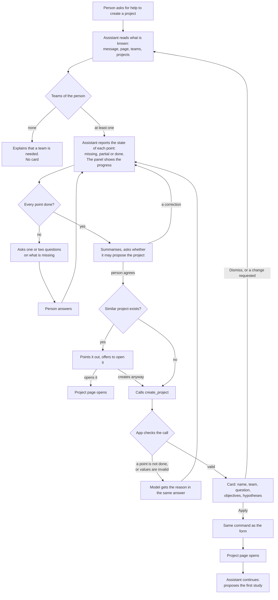

# Journey 1: create a research project

**Status**: built by [spec 018](../../specs/018-agent-create-project/spec.md); tested by the maintainer with a real model.

## Goal

The person ends up on the page of a new project whose research goal is good enough to guide everything that follows: the interview guide, then insights, recommendations and key takeaways.

## Before spec 018

The questions were not in the code: the model wrote them, so they differed between conversations. An empty goal was accepted, an invalid call showed nothing and the model learned of it only at the next message, Apply left a link instead of opening the project, and no test covered the journey.

## What the assistant must find out

The project has three fields: name, team and goal. The goal is described as "question, objectives, hypotheses", and later AI steps receive it (insights, recommendations, key takeaways), as does the debrief deck. The interview guide design also starts from it.

The assistant leads a dialogue, like the interview guide design: it keeps asking until every point below is done, and only then proposes the project.

| Point | What the assistant asks | Stored in | Done when |
|---|---|---|---|
| Research question | What do you want to understand? | Goal: question | The person confirmed a clear question |
| Audience | About whom? | Goal: question | The person named who is concerned |
| Decision to support | What should the results help you decide or do? | Goal: objectives | The person confirmed it. If they do not know, the assistant suggests options to help them choose |
| Hypotheses | What do you expect to find? | Goal: hypotheses | The person gave some, or said explicitly they have none yet |
| Team | Which team is it for? | Team | Only one team, a clear hint, or the person chose |

The assistant suggests the name on the card, so the person is not asked for it.

These are the intents; the assistant adapts the wording to the conversation and its language. A point is done only once the person has answered or confirmed it; what the assistant inferred stays partial until then.

The audience stays part of the question because the project has no audience field. The interview guide design refines it later (profiles, number, recruitment) without asking again what the goal already says.

Interview format, recruitment and questions are not asked here: they belong to the study and its guide.

## Journey

The first study is proposed with its own card and is not created until the person applies it.

Continuing after Apply makes one more AI call, recorded in the usage ledger and shown in the conversation's cost.

## Guarantees

| What must always hold | Enforced by |
|---|---|
| No proposal while a point is open | App: the assistant reports each point with a progress tool, as for the interview guide, and `create_project` is refused unless the latest report of the conversation has every point done. The interview guide has no such check today; this journey adds it |
| No proposal with an empty part | App: `create_project` takes `question`, `objectives` and `hypotheses` instead of a free `goal`, and rejects an empty question or empty objectives. The app composes the goal from them; empty hypotheses read "None yet" |
| The team is one the person can use | App: already checked when the tool is called and again on Apply |
| The model knows at once why a call was refused | App: the tool returns the reason during the answer |
| Nothing is created without Apply | App: already the case |
| The right questions, in a sensible order, without repeating what is known | Instructions to the model: not provable by code, checked by the scenarios below |
| A point marked done was really answered | Instructions to the model: the state is what the model reports, so the app cannot prove it. Checked by the scenarios below |

The form stays as it is: a person who fills it in alone can still create a project with an empty goal.

## How we verify it

Automated, with the test provider ([e2e](../../apps/web/e2e/assistant-create-project.spec.ts), [use cases](../../apps/api/src/modules/assistant/tests/assistant-create-project.test.ts)):

- A call with an empty question, or while a point is not done, is refused and its reason reaches the model; no card appears.
- The panel shows the progress after each answer.
- A valid call shows the card, and Apply creates the project with the composed goal, opens its page and continues the conversation.
- Dismiss creates nothing.

By hand, with a real model, in English and French:

| Person says | Expected |
|---|---|
| "Help me create a research project" | Asks one or two questions at a time, and no card until every point is done |
| "New project on why new users drop off in their first week, to decide what to fix in onboarding" | Has the person confirm what it understood, then asks only for what is missing (hypotheses, then team if needed) |
| The name of an existing project | Points it out and offers to open it |
| "I don't know yet what we'll decide" | Suggests options and keeps asking; no card yet |
| "We have no hypotheses yet" | Accepts it and moves on |
| "Just create it" with points missing | Explains what is missing and asks for it; mentions the form for a project without framing |
| Asks for a project, with several teams | Asks which team |
