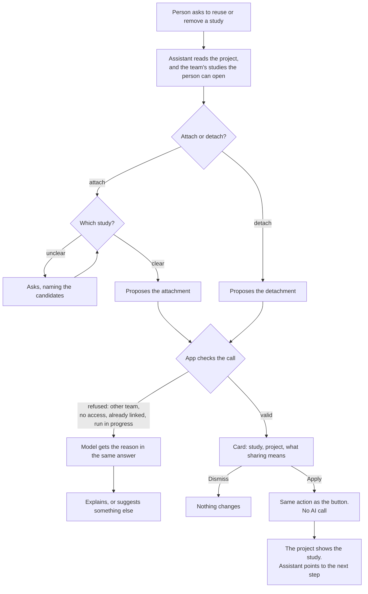

# Journey 2: reuse a study in another project

**Status**: built by [spec 019](../../specs/019-attach-study/spec.md); tested by the maintainer in the app. The assistant's cards and its suggestion of a related study have automated tests with the test provider.

## Goal

An older study and its facts feed a new research project, without redoing the fieldwork or paying for AI again. A study can also leave a project without losing anything.

## Before spec 019

A study belonged to exactly one project, and was deleted with it. The assistant could create and rename a study, but had no way to reuse or detach one.

A study now belongs to a team, like a project, and can only be linked to projects of that team. It also gets its own research goal: its AI steps read it, wherever the study is seen from. The project keeps its goal for the insights, recommendations and key takeaways over all its studies.

The team's studies have their own entry in the main menu, with the same cards as in a project and the number of projects each is in; a study in no project offers to attach it. A study page's breadcrumb follows where it was opened from: the project, or the Studies page.

## What the assistant must find out

| Information | How | Required to propose |
|---|---|---|
| Which study | From the message, among the team's studies in its context; it asks if several match | Yes |
| Which project | The open page, or the person's message | Yes |

The card states what the person needs to decide: decisions on facts are shared between projects when attaching, and where the study stays when detaching (its other projects, or the team's Studies page).

## Journey

A new project also leads here: when the assistant continues after creating a project ([journey 1](01-create-project.md)), it mentions a related study of the team and offers to attach it, as well as creating a new one.

## Guarantees

| What must always hold | Enforced by |
|---|---|
| A study without a project stays reachable | App: it belongs to its team and appears on the team's Studies page |
| A study stays within one team | App: attaching is refused across teams, and so is changing the team of a project sharing a study |
| Nothing of the study is copied or deleted | App: only the link changes |
| Nothing changes without Apply | App: same mechanism as every card |
| The person knows a study is shared | App: the sharing is stated on the card, the study page and the Analysis tab |
| A relevant study is suggested at the right time | Instructions to the model: checked by the scenarios below |

## How we verify it

Automated, with the test provider: attach, detach, every refusal with its reason reaching the model, no AI call, counts in both projects.

By hand, with a real model, in English and French:

| Person says | Expected |
|---|---|
| "Reuse the onboarding study in this project" | Card with the study, the project and the sharing |
| A study name matching two studies | Asks which one, naming them |
| "Remove this study" when it has only this project | Card says it will have no project and stay on the team's Studies page |
| A study of another team | Knows nothing about it |
| Creates a project close to an existing study | Mentions that study after Apply, and offers to attach it |
