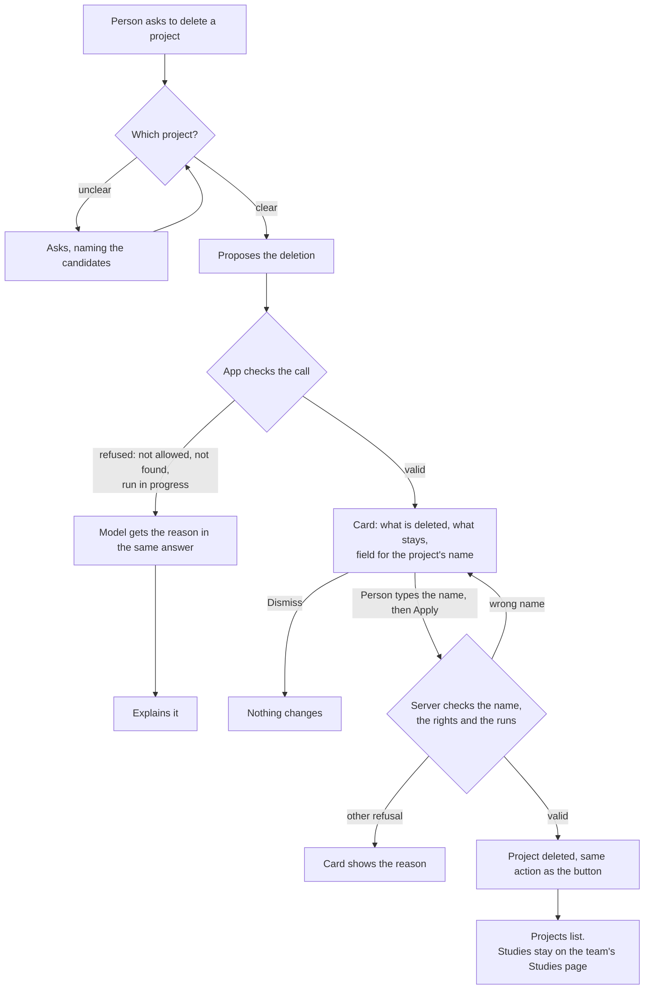

# Journey 3: delete a research project

**Status**: built by [spec 020](../../specs/020-delete-project/spec.md); tested by the maintainer with a real model.

## Goal

A person allowed to do so deletes a project they no longer need, knowing exactly what goes and what stays, and the assistant can never do it alone.

## Before spec 020

No project could be deleted: there was no API, no button and no assistant tool.

## What the assistant must find out

| Information | How | Required to propose |
|---|---|---|
| Which project | The open page, or the person's message; it asks if several match | Yes |
| That the person asked | Their message: it never proposes this by itself | Yes |

The assistant never asks for the name in the conversation: the person types it on the card, and the model never sees or sends it.

## Journey

## Guarantees

| What must always hold | Enforced by |
|---|---|
| Nothing is deleted without the exact name typed by the person | App: the name is required by the server, and only the card's Apply sends it. No tool of the model takes it |
| Only admins and the creator can delete | App: checked on the proposal and again on Apply |
| Studies, facts and decisions stay | App: only the project and what belongs to it are removed |
| Drive files and the usage ledger stay | App: the action does not touch them |
| No deletion during a run | App: checked on the proposal and again on Apply |
| The assistant does not propose it unasked | Instructions to the model: checked by the scenarios below |

## How we verify it

Automated, with the test provider: wrong or missing name, each refusal with its reason reaching the model, studies intact, a study shared with another project, landing on the list.

By hand, with a real model, in English and French:

| Person says | Expected |
|---|---|
| "Delete this project" on a project page | Card with volumes and the name field |
| "Delete the project" from the home page, with several projects | Asks which one |
| "Delete it, its name is X" | Still a card: the person types the name there |
| A long conversation about a finished project, no request | Never proposes a deletion |
| Asks as a team member who is not its creator | No card; explains who can |
