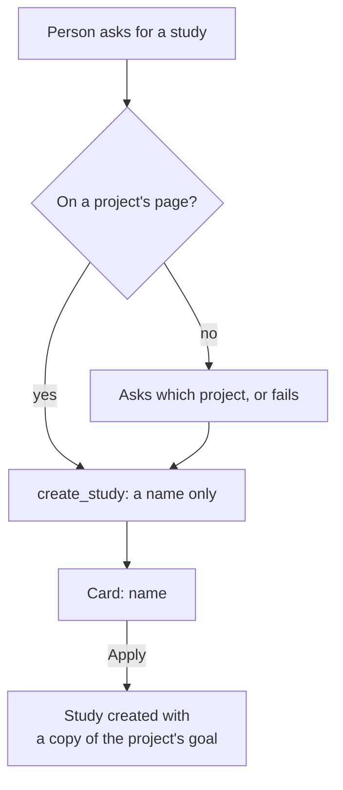
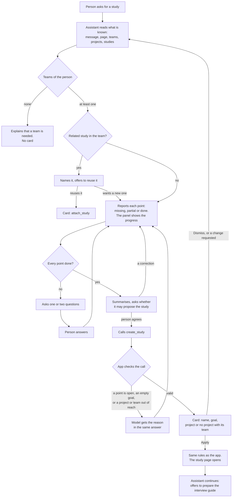

# Journey 4: create a study

**Status**: built by [spec 021](../../specs/021-agent-create-study/spec.md); tested by the maintainer with a real model. The Drive folder comes next, in its own journey.

## Goal

The person ends up on the page of a study that knows what it must learn, in the right project or in none, without duplicating a study the team already has.

## Before spec 021

The assistant showed a card with a name, asked nothing, and the study copied the project's goal. Rephrasing that goal took a second tool afterwards. A study could only be created inside a project. Existing studies were in the context only on a project's page, and nothing led the assistant to compare them.

## What the assistant must find out

| Point | What the assistant asks | Stored in | Done when |
|---|---|---|---|
| Reuse | A study of the team looks related: reuse it? | Nothing, or a link to the existing study | It compared with the team's studies, and the person wants a new one |
| Goal | What must this study learn? It starts from the project's goal when there is one | Study goal | The person confirmed it |
| Place | Which project, or none? Which team, if none and they have several? | Project link, or team | The page or the person settled it |

The assistant suggests the name on the card. It does not ask for the type (interviews only), nor for audience and format, which belong to the guide.

## Journey

The guide is only offered. Continuing makes one more AI call, recorded in the usage ledger and shown in the conversation's cost.

On the team's Studies page, a button creates a study with a name and an optional goal, in no project. The form inside a project stays as it is.

## Guarantees

| What must always hold | Enforced by |
|---|---|
| No card while a point is open | App: `create_study` is refused unless the latest report of the conversation has every point done |
| No card with an empty goal | App: refused when the tool is called |
| The project or team is one the person can use | App: checked when the tool is called and again on Apply |
| The model knows at once why a call was refused | App: the tool returns the reason during the answer |
| Nothing is created without Apply | App: already the case |
| The assistant knows the teams' studies on any page, once framing a study | App: they come with the skill, in a limited list, and it is told when the list is cut |
| The studies compared are really related, and a point marked done was really answered | Instructions to the model: checked by the scenarios below |

## How we verify it

Automated, with the test provider ([e2e](../../apps/web/e2e/assistant-create-study.spec.ts), [use cases](../../apps/api/src/modules/assistant/tests/assistant-create-study.test.ts)):

- A call while a point is open, or with an empty goal, is refused and its reason reaches the model; no card appears.
- The panel shows the progress after each answer.
- A valid call shows the card; Apply creates the study with its goal, in its project or in none, opens it and continues the conversation.
- The Studies page creates a study in no project.

By hand, with a real model, in English and French:

| Person says | Expected |
|---|---|
| After a project is applied | Asks whether to prepare a first study, with no card; the framing starts at the answer |
| "Create a study" on a project's page | Starts from the project's goal, asks what this study must learn; no card yet |
| A subject close to a study of the team | Names that study and offers to reuse it |
| "No, a new one" | Continues towards a new study |
| "A study with no project for now", with several teams | Asks which team; the card says no project |
| "Just create it" with points open | Says what is missing, mentions the forms |
| Asks for a study on the projects list | Knows the projects and studies, asks where it goes |
