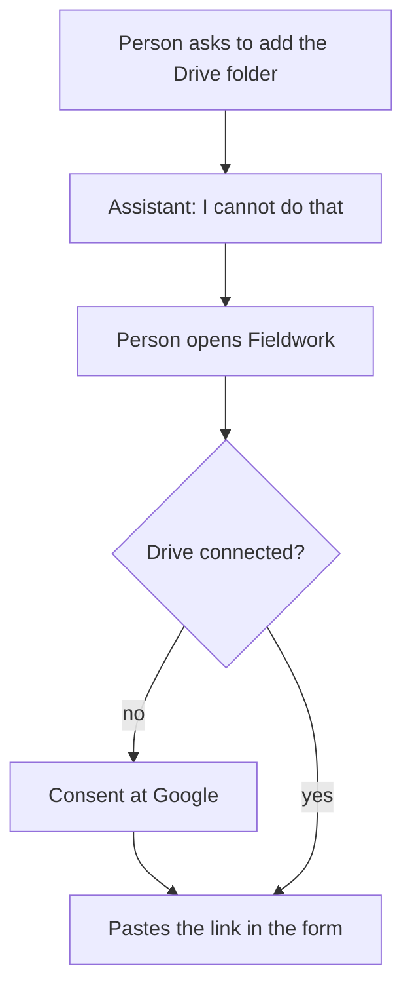
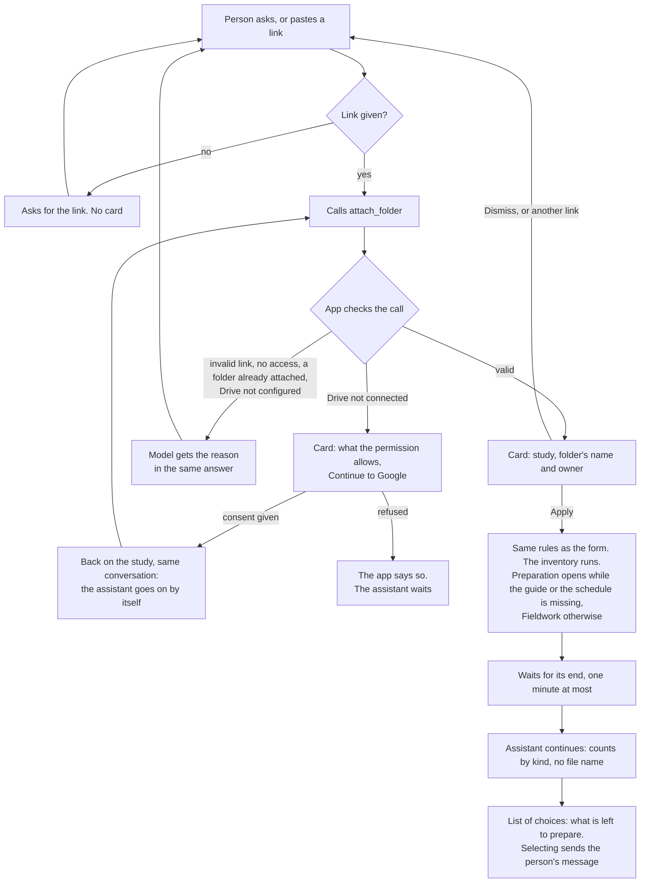

# Journey 5: attach a study's Drive folder

**Status**: built by [spec 022](../../specs/022-agent-study-folder/spec.md); to be tested by the maintainer with a real model and a real Drive.

## Goal

The study holds its interviews: its Drive folder is attached, its inventory has run, and the person knows what was found and what comes next.

## Before spec 022

The assistant knew only the folder's name and had no tool: it answered that it could not add a folder, and the person had to find the form in Fieldwork.

## What the assistant must find out

| Point | What the assistant asks | Done when |
|---|---|---|
| Study | Which study? | The page or the conversation settled it |
| Link | The link of the Drive folder | The person gave it |

Drive's connection and the folder's name are not asked: the app reads them.

## Journey

Right after a study is created, Preparation opens and the assistant offers the folder and the guide as choices, and starts neither.

## Lists of choices

On any answer, the assistant can offer 2 to 6 choices, one or several. The model cannot draw controls, so the app gives it a tool, `offer_choices`. Selecting sends the labels as the person's own message, and nothing else happens: writing freely answers just as well. Only the list of the last answer can be used.

Each answer that goes on by itself makes one more AI call, recorded in the usage ledger and shown in the conversation's cost.

## Guarantees

| What must always hold | Enforced by |
|---|---|
| A valid card only: real folder, opened by this person | App: checked when the tool is called, with the person's own Drive access |
| Nothing is attached without Apply | App: a card, then the form's command |
| A folder is never replaced through the assistant | App: refused when proposing, and on Apply |
| The consent is the person's | App: only a link to Google; the model has no way to give it |
| The assistant goes on only after a real consent | App: checked on the server, from the person's connection |
| No file name reaches the model | App: the context holds counts by kind only |
| Fieldwork never opens before the preparation is done | App: the tab is computed when the card is proposed: a guide, and at least one planned interview |
| A list holds 2 to 6 different choices, and changes nothing | App: checked by the tool; selecting is a plain message |
| The folder is offered at the right time, in sensible words | Instructions to the model: checked by the scenarios below |

## How we verify it

Automated, with the simulated Drive and the test provider ([e2e](../../apps/web/e2e/assistant-study-folder.spec.ts), [use cases](../../apps/api/src/modules/assistant/tests/assistant-study-folder.test.ts)):

- Each refusal reaches the model, with no card.
- The connection card leads to the consent, and the conversation goes on at the return.
- Apply attaches the folder and opens Preparation; the next answer has the counts, no file name, and a list of choices.
- A selection is sent as the person's message, single or multiple.

By hand, with a real model and a real Drive, in English and French:

| Person says | Expected |
|---|---|
| "Add the folder" on a study with none | Asks for the link |
| A folder's link, Drive connected | Card with its name |
| A document's link | Explains it is not a folder |
| A link, Drive not connected | Connection card, then the folder's card at the return |
| "Replace the folder" on a study with one | Refuses, points to Fieldwork |
| Applies the study card | Preparation opens; choices: the folder and the guide |
| Applies the folder card, no guide | Stays on Preparation; choices: the guide, the schedule |
| Applies the folder card, guide and schedule done | Fieldwork opens |
| Ticks two choices | Both are sent; the assistant deals with them in turn |
