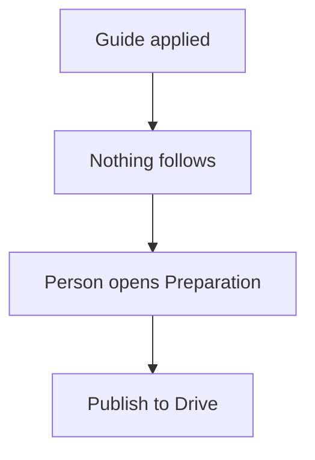
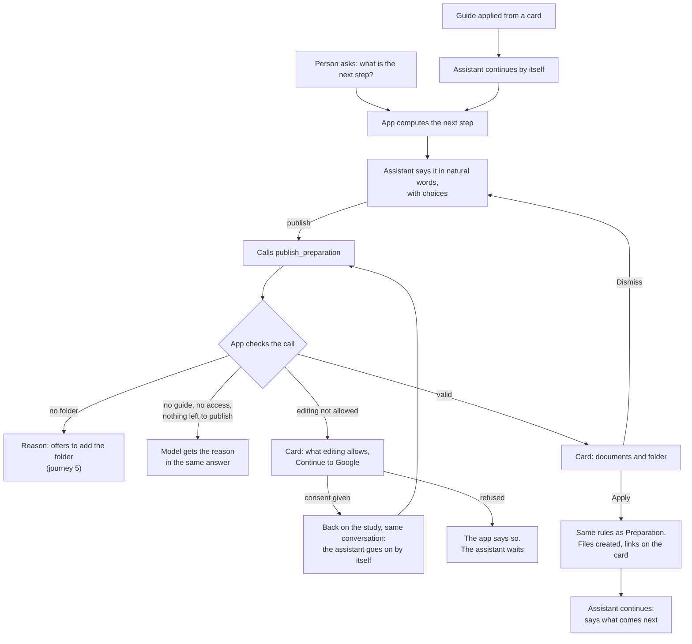

# Journey 6: publish the preparation

**Status**: built by [spec 023](../../specs/023-agent-publish-preparation/spec.md); to be tested by the maintainer with a real model and a real Drive.

## Goal

The team finds the interview guide and the best practices in the study's Drive folder, and the person always knows what comes next.

## Before spec 023

After a guide was applied, nothing followed, and publishing meant finding the button in Preparation. Asked for the next step, the model guessed from what it read.

## What the assistant must find out

Nothing: the study's state says it all. It only needs the person's agreement.

## Journey

Once the guide is applied, the panel's progress bar becomes one line saying the guide is finished, which the person can close.

The next step follows this order:

| State | Next step |
|---|---|
| No guide | Write the guide |
| No folder | Add the folder |
| Guide or best practices not published | Publish them |
| No planned interview | Plan the interviews |
| All done | Run the interviews in Fieldwork |

## Guarantees

| What must always hold | Enforced by |
|---|---|
| The next step reflects the real state | App: computed on each message, given in the context |
| Nothing is written without Apply | App: a card, then Preparation's command |
| A document is never created twice | App: filtered when proposing, refused on Apply |
| The consent is the person's | App: only a link to Google |
| The assistant goes on only after a real consent | App: checked on the server |
| The next step is said naturally | Instructions to the model: checked by the scenarios below |

## How we verify it

Automated, with the simulated Drive and the test provider ([e2e](../../apps/web/e2e/assistant-publish.spec.ts), [use cases](../../apps/api/src/modules/assistant/tests/assistant-publish.test.ts)):

- The next step for each of the five states.
- Each refusal reaches the model, with no card.
- Apply on the card creates both publications; a second proposal is refused.

By hand, with a real model and a real Drive, in English and French:

| Person says | Expected |
|---|---|
| Applies a guide card | Offers to push the guide and the best practices |
| "What is the next step?" in each state | The step of the table, in natural words |
| Agrees, editing not allowed | Consent card, then the publication's card at the return |
| Asks to publish again | Says it is done, and that updates happen in Preparation |
