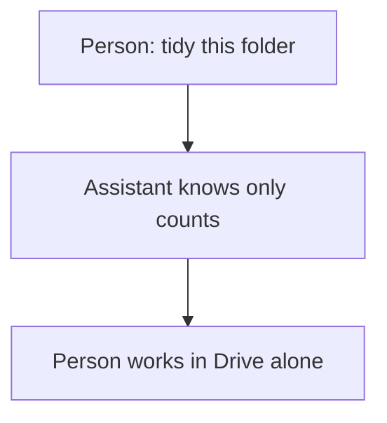
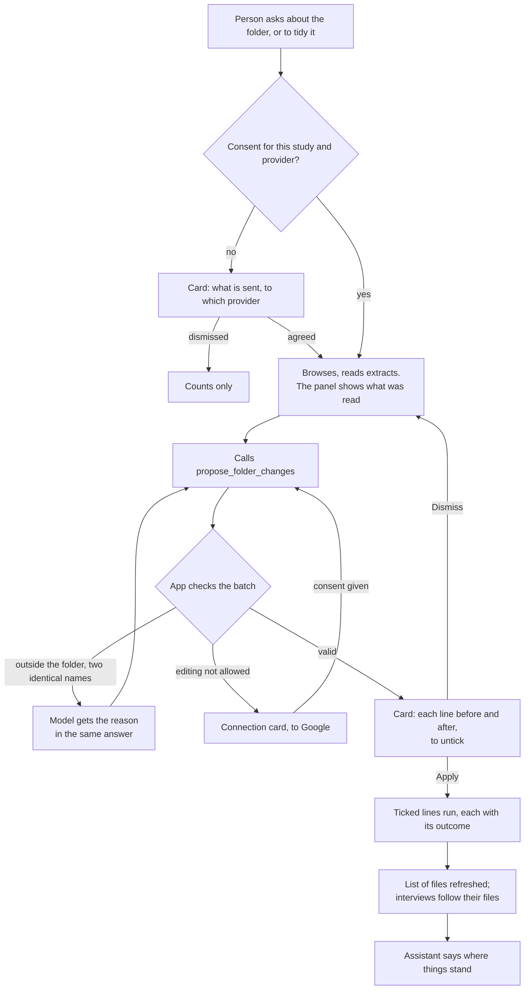

# Journey 7: work in the study's folder

**Status**: built by [spec 024](../../specs/024-agent-drive-folder/spec.md); to be tested by the maintainer with a real model and a copy of a real folder.

## Goal

The assistant helps as a colleague would: it sees the study's folder, reads its files, and prepares the tidying. The person validates everything that changes.

## Before spec 024

The assistant knew the folder's name and the number of files by kind. It could not see a file name, open a file or change anything.

## Journey

## Its tools

| Tool | What it does | Card |
|---|---|---|
| `find_files` | Finds by name or kind, anywhere in the folder | Consent, the first time |
| `browse_folder` | Everything in the folder, in one call | Consent, the first time |
| `read_file` | One extract, 8,000 characters, 5 per answer | Consent, the first time |
| `propose_folder_changes` | Renames, moves, new sub-folders | Always, each line to untick |

The panel shows the tools used above the answer, in the order things happen: the person's message, the tools, the answer, then any card. A shortcut stands for the file it points to.

## Guarantees

| What must always hold | Enforced by |
|---|---|
| No file name or extract without consent | App: the tools refuse, and the context holds counts |
| Nothing outside the study's folder | App: each id checked against the folder, with the person's own access |
| Nothing deleted or trashed, no sharing changed | App: no such line exists, and no such operation in the code |
| Nothing changes before Apply, and only ticked lines | App: a card, then the command |
| An interview keeps its decisions when its file moves | App: files are followed by id |
| The person is never left without a word | App: an answer ending on a tool with nothing written says so, in their language |
| Sensible tidying, a useful reading | Instructions to the model: checked by hand |

## How we verify it

Automated, with the simulated Drive and the test provider ([e2e](../../apps/web/e2e/assistant-folder-work.spec.ts), [use cases](../../apps/api/src/modules/assistant/tests/assistant-folder-work.test.ts), [Drive rules](../../apps/api/src/modules/ingestion/tests/folder-work.test.ts)): consent, refusals, untick, per-line outcomes, interviews after a move.

By hand, with a real model and a real Drive, in English and French:

| Person says | Expected |
|---|---|
| "What is in the folder?" | Consent card, then a description |
| "What does this transcript say?" | Draws on an extract; the panel names the file |
| "Tidy this folder" | One card; files not useful go to "To sort" |
| "Delete this file" | Explains it cannot, offers "To sort" |
