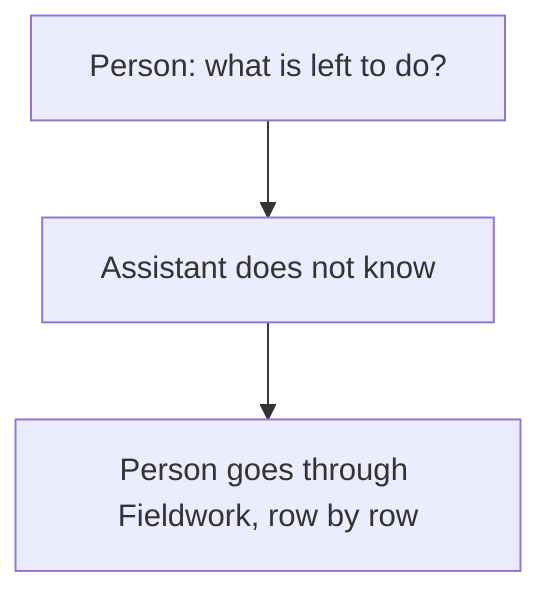
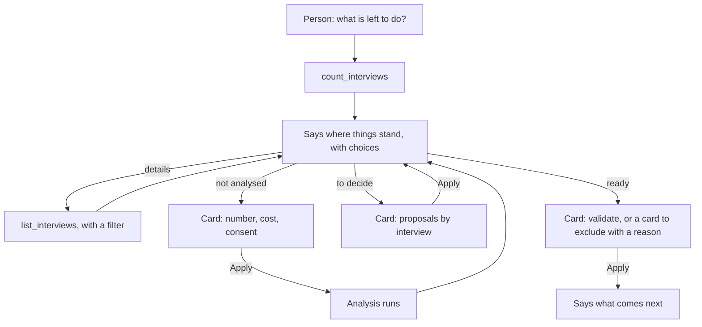

# Journey 8: interviews

**Status**: specified by [spec 025](../../specs/025-agent-interviews/spec.md). Built, to be tested by the maintainer with a real model.

## Goal

The person knows what is left to do on their interviews, and clears it in a few cards: analysing, deciding, validating.

## Today

The assistant sees no interview. Everything happens row by row in the Fieldwork tab.

## Its tools

| Tool | What it does | Card |
|---|---|---|
| `count_interviews` | Numbers by state, no name | None |
| `list_interviews` | Filters, combined and optional: to decide, without transcript, without recording, not analysed, ready to validate, validated, excluded, part of a name, or of a person's name on its roster or in a suggestion. Without any filter, every interview. 50 per page | Consent, the first time |
| `propose_analysis` | Starts the analysis | Number, cost, consent |
| `propose_accepting_suggestions` | Shows the analysis's suggestions by interview; Apply accepts those ticked | Consent, the first time; lines to untick |
| `propose_validating_interviews` | Shows the interviews ready; Apply validates those ticked | Consent, the first time; lines to untick |
| `propose_excluding_interviews` | Shows interviews to exclude, with a reason; Apply excludes those ticked | Consent, the first time; lines to untick, reason |

The assistant has no tool that validates or accepts: only the person's Apply on a card does, through the app.

## Journey

## Guarantees

| What must always hold | Enforced by |
|---|---|
| No interview name without consent, never on an anonymised study | App: the tool refuses; counts hold no name |
| A filter gives exactly what it says | App: computed, never by the model |
| Nothing changes before Apply, only ticked lines | App: a card, then the Fieldwork commands |
| A person's decision is never overwritten | App: cards only touch what is undecided, and an interview changed since the card stops its line |
| Consent to an analysis is what the card states | App: Apply fails if the provider changed, and gives consent only if the card asked for it |
| The lines of a card stay in the app | App: only interview ids go back to the model in later turns |
| A document is not a transcript, and only a person validates | App: an attachment stays one, and no tool validates; the tab shows a document without transcript in amber, and nothing at all in red. Said by the model: checked by hand |
| A useful summary, the right filter | Instructions to the model: checked by hand |

## How we verify it

Automated, with the simulated Drive and the test provider ([e2e](../../apps/web/e2e/assistant-interviews.spec.ts), [use cases](../../apps/api/src/modules/assistant/tests/assistant-interviews.test.ts), [filters](../../apps/api/src/modules/ingestion/tests/interview-filters.test.ts)): filters alone and combined, consent, cards, outcomes, next step.

By hand, with a real model, in English and French:

| Person says | Expected |
|---|---|
| "What is left to do?" | Counts and choices, no list |
| "Which ones have no video?" | Only those |
| "What is left to decide on Nadia?" | Her proposals |
| "Analyse the rest" | Card with the cost |
| "Accept everything" | Card, with doubtful lines unticked |
| "Exclude this one" | Asks for the reason |
