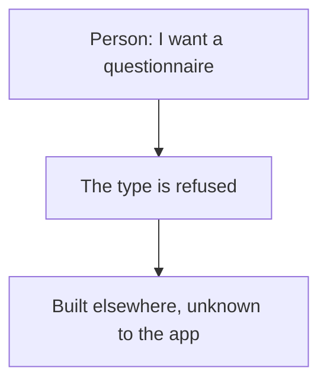
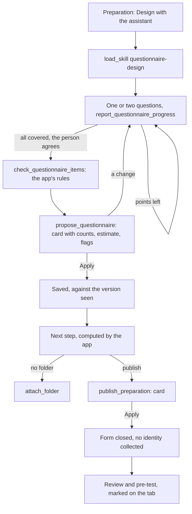

# Journey 9: questionnaire

**Status**: specified by [spec 027](../../specs/027-survey-preparation/spec.md). Built; the real form service and a real model remain to be tested by the maintainer.

## Goal

The person has a questionnaire built with method, in a form in the study's folder, closed to responses and ready for Fieldwork (spec 028).

## Today

Before this journey, a survey study could not be created.

## What the assistant must find out

| Information | Why | Stored |
|---|---|---|
| A concrete objective, then themes | Everything else serves them, in this order | Framing, sections |
| Hypotheses | Items to confirm or refute them | Framing |
| Target audience, recruitment, number of responses and its reason | Profiling items, and how far results can be read | Framing |
| How it is administered, consent | Anonymity, social desirability | Framing |
| Items and their format | A fact is a choice, a perception a scale | Items |

It never asks for names: a questionnaire holds none.

## Journey

## Guarantees

Enforced in code, not left to the model:

- The questionnaire tools exist only on a survey study the person can change; a proposal for another study is refused.
- Nothing is saved or published before Apply; a stale version is refused.
- The percentage, the writing checks and the estimated time are computed by the app.
- The form is closed to responses, sets identity collection off, and its consent's refusal ends it.
- Nothing read from the form changes the app without a person's decision; what the app cannot hold is only reported.
- The next step advises; review and pre-test block nothing.

## How we verify it

- Tests: `questionnaire*.test.ts`, `form.test.ts`, `publication-questionnaire.test.ts`, `google-forms.test.ts`, `assistant-questionnaire.test.ts`, `questionnaire.component.test.ts`, `e2e/questionnaire.spec.ts`.
- With a real form service: [quickstart, scenario 5](../../specs/027-survey-preparation/quickstart.md).
- With a real model: design a questionnaire on a topic you know. Does it follow the order? Does it refuse a Likert scale for a fact? Does it say plainly that themes stay in order?
