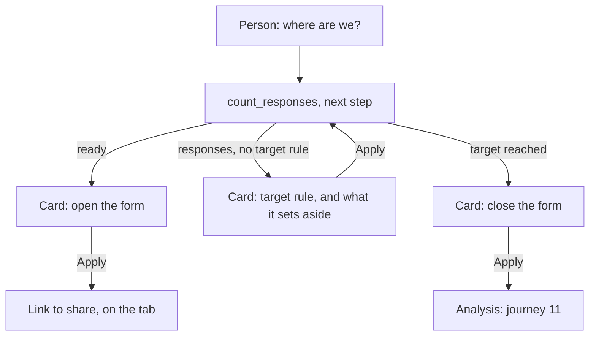

# Journey 10: survey fieldwork

**Status**: specified by [spec 028](../../specs/028-survey-fieldwork/spec.md). Built; the real form service and a real model remain to be tested by the maintainer.

## Goal

The person knows how many usable responses they have, and opened, filtered and closed in a few cards.

## Before

The form stayed closed: the only way to collect was by hand in the form, and the app saw nothing.

## What the assistant must find out

| Information | Why | Stored |
|---|---|---|
| Which answers belong to the target | To filter out who is outside it | TargetRule |

It starts from the target audience of the framing, and uses the options word for word.

## Its tools

| Tool | What it does | Card |
|---|---|---|
| `count_responses` | Counts by state, no answer | None |
| `propose_opening_form` | Opens the form | Apply; same refusals as the screen |
| `propose_closing_form` | Closes the form | Apply |
| `propose_target_rule` | The accepted answers per profiling item | Apply; says how many it would set aside |

## Journey

## Guarantees

- No tool gives an answer of a response, and the contact item never reaches the app.
- Opening is refused while the form collects identities, its consent does not end it, or it is not in sync.
- A rule only takes choice items of a profiling section, and their options.
- States and counts are computed by the app, and nothing is deleted.
- Nothing changes before Apply.

## How we verify it

- Tests: `responses.test.ts`, `read-responses.test.ts`, `publication-questionnaire.test.ts`, `assistant-questionnaire.test.ts`, `surveys.component.test.ts`, `e2e/survey-fieldwork.spec.ts`.
- With the real service: [quickstart, scenario 4](../../specs/028-survey-fieldwork/quickstart.md).
- With a real model: ask where things stand. Does it invent an answer? Does it propose a sensible rule from the target audience?
