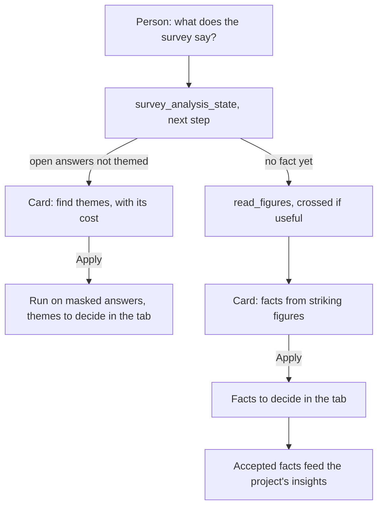

# Journey 11: survey analysis

**Status**: specified by [spec 029](../../specs/029-survey-analysis/spec.md). Built; a real model and the person's real survey remain to be tested by the maintainer.

## Goal

The person knows what the survey says, figure by figure and group by group, reads the themes of its open answers, and turns what matters into facts the project's insights use.

## Before

Responses were counted and filtered, but nothing read them: no figure, no theme, no fact.

## What the assistant must find out

| Information | Why | Stored |
|---|---|---|
| Which figures matter to the research goal | To propose facts from them | Survey facts, on Apply |
| Which open item to theme | A theme run costs a call per 150 answers | ThemeRun, on Apply |

It never computes a figure: it cites those of `read_figures`. It never sees an answer.

## Its tools

| Tool | What it does | Card |
|---|---|---|
| `survey_analysis_state` | Counts: responses, open items and their themes, facts by status | None |
| `read_figures` | Figures computed by the app, optionally crossed by a profiling item | None |
| `propose_survey_facts` | Facts from figures; the app writes each statement | Apply; each figure checked against today's |
| `propose_theme_analysis` | Themes of one open item's masked answers | Apply; shows the cost and the provider |

## Journey

## Guarantees

- No tool gives an answer; open answers reach the provider only masked, in a theme run the person confirmed (ADR-0012).
- Figures and statements of figure facts are computed by the app, never by AI.
- The tab's own "Find facts" works as `propose_survey_facts`: the AI points at figures and accepted themes, the app checks and writes each fact.
- A fact keeps the figure it was made from; a figure that moves shows "Figure changed".
- Nothing changes before Apply, and every call's cost shows in the Analysis tab.

## How we verify it

- Tests: `figures.test.ts`, `themes.test.ts`, `survey-facts.test.ts`, `survey-fact-commands.test.ts`, `assistant-survey-analysis.test.ts`, `confidence.test.ts`, `survey-analysis.component.test.ts`, `e2e/survey-analysis.spec.ts`.
- With a real provider: [quickstart, real provider](../../specs/029-survey-analysis/quickstart.md).
- With a real model: ask what the survey says. Does it quote a figure the app did not give? Does it propose facts on small bases without saying so?
