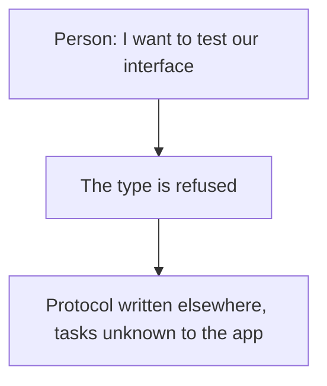
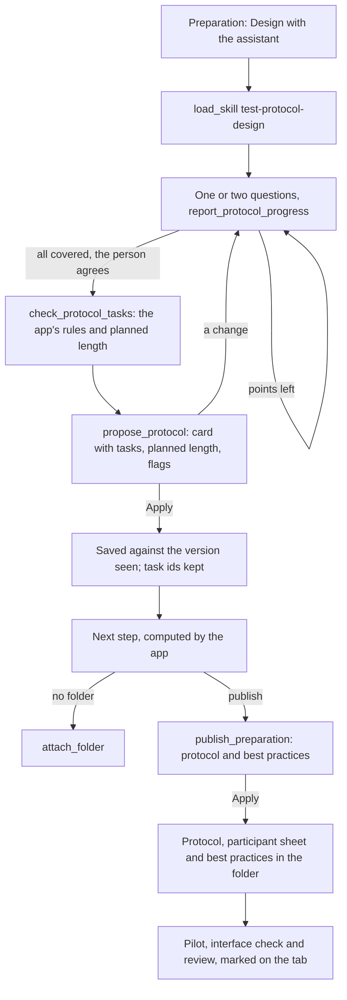

# Journey 12: usability test preparation

**Status**: specified by [spec 036](../../specs/036-usability-test-preparation/spec.md). Built; the real Docs service and a real model remain to be tested by the maintainer.

## Goal

The person has a test protocol for a usability test: the tested interface, a scenario, tasks with their success criteria, the optional standard questions, and the facilitator's script. It is published in the study's folder with a participant sheet, and every recorded session can later be read task by task against it.

## Today

Before this journey, a usability test study could not be created: the type was shown as coming later, and test protocols were written elsewhere, unknown to the app.

## What the assistant must find out

| Information | Why | Stored |
|---|---|---|
| The objective and hypotheses, from the study's research goal | They decide which tasks to write | Framing |
| The tested interface: link and kind | Where the participant starts; never opened by the app | Framing |
| Participants | People who will really use it, not the builders | Framing |
| Format, session length, consent | The planned length is checked against it; the consent says recordings are read by an AI service | Framing |
| A scenario | The tasks' real-life context | Scenario |
| Tasks, each with a success criterion | What each session is judged against, by task | Tasks |
| Standard questions and debrief | Comparable numbers across sessions; the texts are the app's | Questionnaire settings, script |

It never asks for names: a protocol holds none.

## Journey

## Guarantees

Enforced in code, not left to the model:

- The protocol tools exist only on a usability test study the person can change; a proposal for another study, or breaking the limits (1 to 15 tasks, web addresses only), is refused.
- Nothing is saved or published before Apply; a stale version is refused; a task keeps its id when its instruction is kept, and a removed task's id is never reused.
- The percentage, the writing checks and the planned length are computed by the app; the System Usability Scale and the ease question are fixed texts, never written by a model.
- The tested interface link is text for the assistant: the app never opens or fetches it.
- Publishing the protocol publishes its participant sheet, which holds no success criterion; changes made to the sheet in Drive are reported and never taken in.
- The anonymisation setting says it does not apply to the recordings read by the AI service.
- The next step advises; the checks before the first session block nothing.

## How we verify it

- Tests: `test-protocol*.test.ts`, `protocol-checks.test.ts`, `protocol.test.ts`, `publication-protocol.test.ts`, `assistant-protocol.test.ts`, `protocol-progress.test.ts`, `test-protocol.component.test.ts`, `e2e/usability-preparation.spec.ts`.
- With a real Docs service: [quickstart, scenario 6](../../specs/036-usability-test-preparation/quickstart.md).
- With a real model: design a protocol for an interface you know. Does it refuse "click on…" instructions? Does it ask for a success criterion per task? Does it leave the standard questions' texts to the app?
