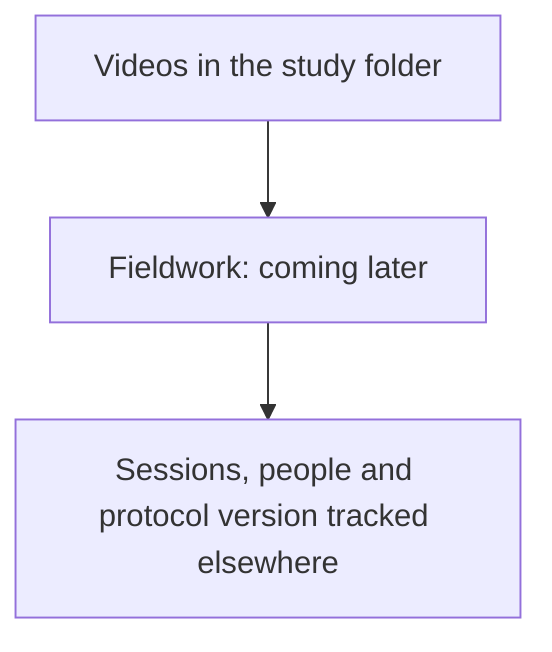
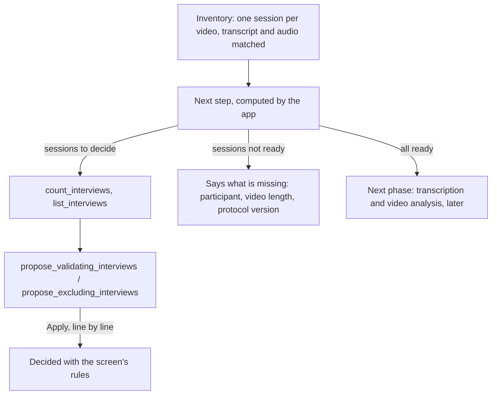

# Journey 13: usability test sessions

**Status**: specified by [spec 037](../../specs/037-usability-test-fieldwork/spec.md). Built; a real Drive folder of recorded sessions and a real model remain to be tested by the maintainer.

## Goal

The person knows which test sessions were run, with their video, transcript, participant, facilitators and protocol version, and which of them are ready for the video analysis of the next phase.

## Before

The Fieldwork tab of a usability test study said that test sessions would come in a later version. Videos sat in the folder, unknown to the app, and nothing told which protocol version a session was run against.

## What the assistant must find out

Nothing to ask: the app finds the sessions in the folder. The assistant reads counts, and lists under the folder consent.

| Information | Why | Stored |
|---|---|---|
| Sessions by state, readiness and video minutes | Answer "where are we", without names | Computed from the sessions |
| The sessions matching a filter (to decide, without transcript, not analysed, not ready, by name) | Propose the right cards | Read under the folder consent, never on an anonymised study |

## Journey

## Guarantees

Enforced in code, not left to the model:

- A session exists only with its video; a transcript no video claims is listed and gives none.
- The video's length comes from the source's metadata; no video or audio content is read or sent anywhere.
- The AI reads only a transcript's beginning, with the usability roles named; without a transcript, only the app's rules propose people.
- Names reach the AI only under the folder consent, and the names the app knows never on an anonymised study.
- Every saved protocol version is kept unchanged; the app proposes the one saved before the session's date, a person's choice is kept.
- Readiness is computed by the app; the cards apply the same rules as the screen.
- No schedule, planned interview or "Add to the schedule" on a usability test study.

## How we verify it

- Domain: `video-sessions.test.ts` (reconciliation from videos, merging, protocol version, readiness, names).
- Use cases: `usability-sessions.test.ts`; next steps in `protocol-progress.test.ts`.
- Component: `test-protocol.component.test.ts` (sessions, versions and the protocol-version route on Postgres).
- End to end: `usability-fieldwork.spec.ts`, with axe in light and dark themes.
- By hand: a real Drive folder of recorded sessions, durations read, a video still processing shown "length unknown", files renamed with the person's access; "where are the sessions?" with a real model.
