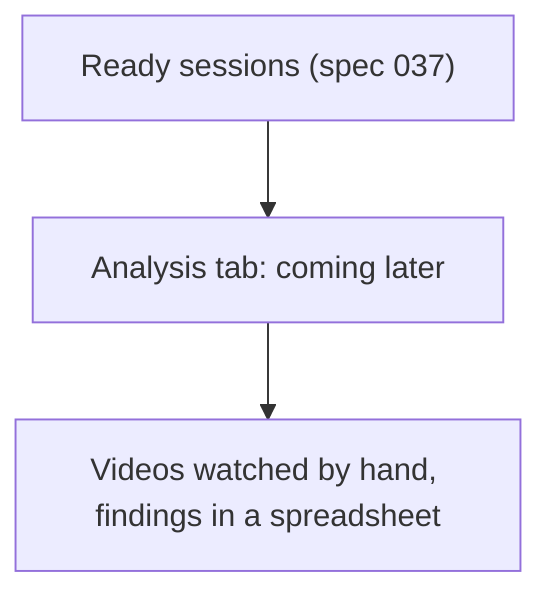
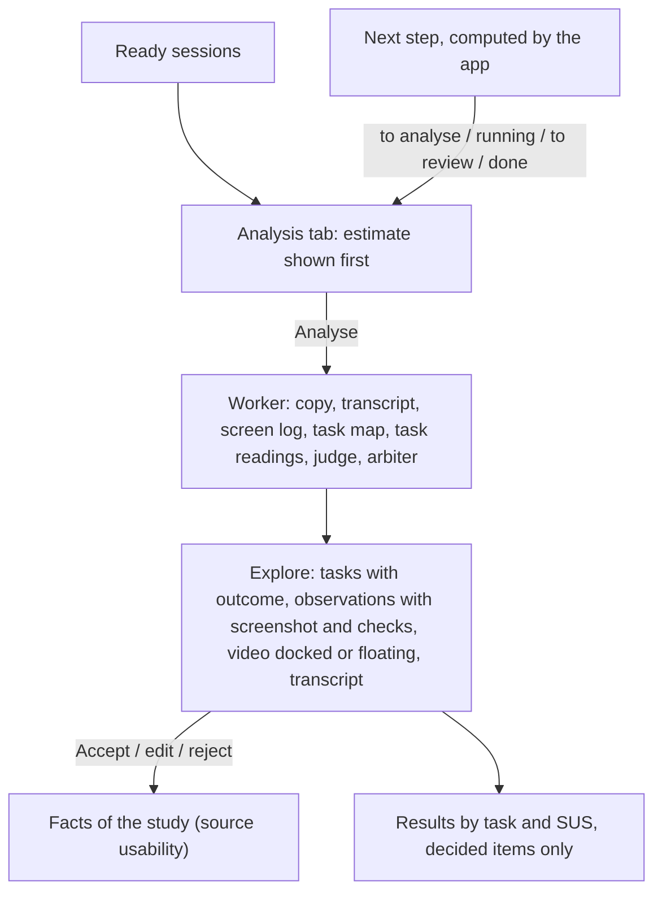

# Journey 14: usability test analysis

**Status**: specified by [spec 038](../../specs/038-usability-video-analysis/spec.md). Built with the dev provider; a real Vertex AI project and real sessions remain to be tested by the maintainer.

## Goal

The person knows, for each task of the test, how many participants succeeded, where they struggled and how long it took, with each finding traceable to a moment of a video, and the System Usability Scale score; decided findings feed the project as facts.

## Before

Ready sessions stopped at the Fieldwork tab: watching hours of video task by task was left to the team.

## What the assistant must find out

Nothing to ask: the app knows the ready sessions and the protocol. The assistant reads counts without names.

| Information | Why | Stored |
|---|---|---|
| Sessions ready, analysed, to analyse; items to review; cost so far | Say where the study stands and the next step | Computed from the analyses |

## Journey

## Guarantees

Enforced in code, not left to the model:

- Only ready sessions are analysed, with the folder consent, on Vertex AI (or the dev fake); the estimate is shown before.
- The video is copied for the analysis only and deleted at the end; the bucket deletes anything older than a day.
- An observation reaches the person only with a quote found in the transcript and a moment within its task; the judge never rejects without contrary evidence; every doubt goes to the arbiter.
- Only decided items count; a decided observation gives a fact, a rejected or reopened one withdraws it.
- Every call is in the ledger under the session; its cost shows per session and per study.

## How we verify it

- Domain: `usability/tests/domain.test.ts`; use cases: `usability/tests/analysis-run.test.ts`; media tools on a real video: `media-tools.test.ts` (with ffmpeg).
- Component: `apps/api/tests/usability-analysis.component.test.ts` (Postgres: run, checks, facts, results, access, sweep).
- End to end: `usability-analysis.spec.ts`, with axe in light and dark themes.
- By hand: one real 30-minute session on a Vertex AI project: bucket created with its one-day rule, copy deleted, outcomes against the trial, cost per minute, player seeking in Drive.
