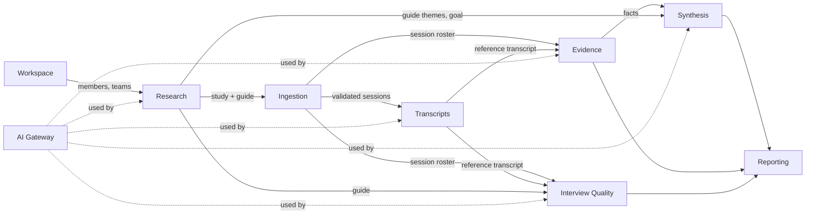

# Domain model & context map

> Living document. It is the reference for the ubiquitous language: code, API, UI and specs use these terms. Any change goes through a spec (`/speckit-specify`) or an ADR.

## Product in one sentence

goodresearch helps teams **design better user studies and trust their answers**: prepare an interview guide, collect recordings and transcripts, clean them, check interview conduct, extract evidence (facts), synthesise it into insights and recommendations, and present them — with **AI proposing and humans validating** at every step.

## Core principle: AI proposes, humans decide

Every AI-produced object follows the same lifecycle and the same protections. This is a cross-cutting domain rule, not a UI detail.

- Status: `proposed → validated | rejected`. Only humans validate or reject.
- `edited` objects are never overwritten by a new AI pass.
- Regeneration is **incremental**: it adds, it never rewrites or deletes human decisions.
- Removed links are kept as tombstones (`removed`) so the AI never re-adds them.
- Rejected items are fed back to the AI as "do not propose again".
- Anything the AI quotes (terms, quotes, original text) is **verified verbatim** against the source, otherwise dropped.
- Derived metrics (confidence, polarity, talk share, priority) are **computed by the app, deterministically**, never by the model.
- **Review policy** (`auto` = proposals count unless rejected, `manual` = only validated items count) is a **project-level** setting applied **at read time**. It never mutates data.

## Subdomains and bounded contexts

| # | Context | Subdomain type | Modelling style | Main aggregates |
|---|---|---|---|---|
| 1 | **Workspace** | Generic | CRUD + auth library | Workspace, Account, Member, Team (with memberships), UserPreferences |
| 2 | **Research** | Core | Domain model | Project, Study, InterviewGuide |
| 3 | **Ingestion** | Supporting | Domain model (matching rules) | Source, Session (with its roster) |
| 4 | **Transcripts** | Supporting | Domain model | Transcript, LexiconTerm, CorrectionRun |
| 5 | **Interview Quality** | Core | Domain model + policies | Evaluation |
| 6 | **Evidence** | Core | Domain model | Participant, Fact |
| 7 | **Synthesis** | Core | Domain model + policies | Insight, Recommendation, KeyTakeaways |
| 8 | **Reporting** | Supporting | Read models only (no aggregates) | — (deck, graph, evidence chain, exports) |
| 9 | **AI Gateway** | Generic | Adapters + ledger | UsageEntry (append-only), PricingCatalog |

Background jobs (`Job`, per-item progress, stop, retry) are **shared infrastructure** used by contexts 3–7, not a context of their own.

Integration rules between contexts: reference by **ID only**, communicate through each module's **public API** (`index.ts`) or **domain events**. No shared tables, no cross-module imports of internals.

## Ubiquitous language

### 1. Workspace

- **Workspace** — the tenant (one per instance for now). Holds members, teams, provider configuration (LLM, sources) and organisation context given to the AI (replaces any hard-coded company context).
- **Account** — a person who can sign in, only through an external identity provider (no passwords), active, deactivated or deleted. New accounts come from a provider sign-in, filtered by the deployer's **initial admin emails** and **access allow-list** (emails and email domains).
- **Member** — an account in the workspace, with a role: `admin` (manages teams, members and access; sees everything) or `member`. The last active admin cannot be demoted or deactivated.
- **Team** — the unit of access and ownership. Unique name per workspace (case/space-insensitive). A team with projects cannot be deleted.
- **TeamMembership** — links an account to a team (an account can be in several teams). A member sees and edits exactly the projects of their teams; a new member starts with none.
- **AccessEvent** — immutable record of an access change (who, on whom, what, when); admins consult it per account.
- Account lifecycle: `active ⇄ deactivated → deleted`. Deletion anonymises the account (name and email erased) so references and history stay consistent. Provider sign-in requires a verified email unless the deployer trusts the provider; a verified (or trusted) email matching an active account attaches to it.
- **UserPreferences** — interface language (`fr`, `en`).

### 2. Research

- **Project** — a research question. `name`, `goal` (question, objectives, hypotheses — given to the AI everywhere), `reviewPolicy` (`auto | manual`), **exactly one team** (required; access follows the team). Linked to 0..n studies (many-to-many). Its key takeaways are owned by the Synthesis context.
- **Study** — one source of evidence that can feed several projects. `type` (`interviews` first; `survey`, `usability-test`, `documents`, `analytics` later), phases **Preparation → Fieldwork → Analysis**.
- **InterviewGuide** — the protocol of a study: ordered **GuideQuestions** (`id`, `section`, `text`) plus protocol markdown. Built by the **guide assistant** (chat) or imported from a document. It is the hub: it feeds evaluation coverage, insight themes and the deck.
- **GuideConversation** — messages with the guide assistant and a **completeness checklist** (objectives 15, hypotheses 10, audience 15, format 10, intro 10, themes 25, follow-ups 10, bias review 5 = 100). The assistant signals `readyToWrite`; the app computes the percentage.
- **PublishedDocument** — an export of something the app owns (guide, best-practices, schedule) to an external tool. The app stays the source of truth.

### 3. Ingestion

- **Source** — where a study's files live (`Connector`: Google Drive first; upload, other drives later). Holds the last **inventory** of files with `kind` (`transcript | media | other`) and `group` (first-level folder).
- **Source connection** — a person's own grant to read a connector (e.g. Drive), separate from sign-in, encrypted, revocable; never used for someone else's request.
- **Folder access** — a study with a source folder has a second access barrier: on top of the project's team, a person must have access to the folder at the source. Without it they see only the study's name and type. Admins can always detach the folder or delete the study.
- **Session** — one interview occurrence: at most one transcript file + 0..n ordered media files. `status` `proposed | validated | excluded`, `matchConfidence` `high | medium | low` with a reason, optional custom title.
- **Roster** — the people of a session, owned by the Session: **Interviewers** (the people conducting it, optionally linked to a workspace Member) and **Interviewees** (the people interviewed). Suggested from metadata, validated by the user. Other contexts reference roster entries by ID.
- **Matching policy** — proposes sessions from file metadata. Rules (initial heuristic): only within a group; identical timestamp → high; same day ≤15 min or shared rare word → medium; shared rare word without date → low; different days → incompatible. A rare word appears in ≤3 files of the group.
- Invariants: re-scanning replaces only `proposed` sessions; validated/excluded sessions and their files are **frozen**; a frozen file cannot be used elsewhere; a session needs at least one file; reopening ("back to review") is the only way to change a decided session.

### 4. Transcripts

- **Transcript** — the text of a session, with **versions**: `raw` (imported, immutable) and successive `clean` versions. Each version is a list of **Segments**.
- **Segment** — one speaker turn: `id` (**stable across versions**), `speaker`, `start`/`end` (nullable), `text`. Everything downstream anchors on `(transcriptVersionId, segmentId, offsets)` — never on a positional index.
- **TranscriptParser** — strategy per format (VTT, SRT, plain `Speaker: text`, meeting-notes exports…). Unusable input → `unavailable` with a reason.
- **Speaker mapping** — explicit, user-validated mapping from transcript speaker labels to **roster** entries (interviewer or interviewee) of the session (replaces name heuristics everywhere).
- **LexiconTerm** — workspace-level glossary entry per language: `surface`, `kind` (`domain | suspect`), `correction`, `scope` (`global | caseByCase`), status. Has **Occurrences** (recomputed) and **Verdicts** (user yes/no per occurrence, survive recounts).
  - Match rule: whole word/phrase; all-caps acronyms case-sensitive, others case-insensitive. Same rule server and UI (shared package).
  - Default scope `caseByCase` when the surface has ≤3 characters or is spread much wider than flagged; user choice wins once set.
  - Re-extraction never overwrites a human decision; while undecided, `suspect` wins over `domain`.
- **CorrectionRun** — a versioned correction pass producing **Edits** (`segmentId`, offsets, original, replacement, `origin` `user | rule | ai-lexicon | ai-other`, confidence, reason, status). Overlap priority: user > rule > ai-lexicon > ai-other. An identical edit inherits the earlier human decision. **Publishing** a run creates a new clean version.

### 5. Interview Quality

- **Evaluation** — per session, assesses interviewer neutrality. Each **interviewer intervention** (a segment spoken by an interviewer) is classified (`guide | follow-up | reformulation | context | opinion`).
- **Policies** (app-computed, word-weighted):

  | Metric | OK | Watch | Bad |
  |---|---|---|---|
  | Interviewer talk share | ≤30% | ≤40% | >40% |
  | Opinion / leading share | ≤5% | ≤10% | >10% |
  | Follow-up + guide share | ≥60% | ≥40% | <40% |

  >95% interviewer words → *not measurable* (no verdict, excluded from averages). Guide coverage is indicative only (lower bound, no verdict).

### 6. Evidence

- **Participant** — anonymous research profile of an interviewee (references a roster entry): `role`, `team`, `description`, status. Gets a **stable pseudonym** (`P01`…) at workspace level, assigned once. Evidence owns the profile; Ingestion owns who was in the session.
- **Fact** — an atomic piece of evidence: neutral `statement` (no names), exact `quote` anchored on a segment, `polarity` (`positive | negative | neutral`), origin (`ai | manual`), status.
  - Only participant speech produces facts. Quote verified (tolerant to case/whitespace/apostrophes) or dropped.
  - Incremental extraction; duplicates (same segment and contained quote or ≥60% shared words) are discarded.
  - Manual facts are created validated; deleting an AI fact rejects it (so it is never proposed again).
  - Attribution follows the speaker mapping: fixing a mapping re-attributes facts without re-extraction.
  - When a new transcript version is published, quotes are **re-anchored**; facts whose quote disappeared are flagged, not deleted.

### 7. Synthesis

- **Insight** — project-level finding: `theme`, `statement`, `description`, counter-evidence, minority view, status. Links to facts with a role (`support | counter | removed`) and origin (`ai | manual`).
  - Only known fact ids may be cited; an insight without valid support is dropped.
  - **ConfidencePolicy**: panel = participants with facts in the project. High ≥ max(5, 30% of panel) participants AND ≥3 teams AND no team >50%; Medium ≥3 participants; Low otherwise; counter-evidence from ≥50% as many participants lowers one level.
  - **PolarityPolicy**: neutral if polarised facts <30%; positive/negative if ≥60% of polarised; mixed otherwise.
  - Themes come from the guide sections (+ "Other"); free themes without guide.
- **Recommendation** — `action`, `rationale`, `kind` (`build | test | investigate`), `impact`/`effort` (H/M/L), `successMeasure`, `owner`, status, links to insights. A `build` backed only by low-confidence insights becomes `test`. **PriorityPolicy** = impact×2 − effort.
- **KeyTakeaways** — the project's 2–4 sentence summary (one per project, referenced by project ID). AI may draft, never saved automatically.

### 8. Reporting (read models)

Deck (debrief presentation), project graph, evidence chain (recommendation → insights → facts → sessions), anonymised fact export (CSV: no names, no session titles), costs. Built from queries; no aggregates, no writes.

### 9. AI Gateway

- **LlmProvider** port — structured output (schema-constrained), usage metadata, transient-error classification. Adapters per provider (via Vercel AI SDK).
- Concurrency cap per provider credential, retries with backoff on transient errors.
- **UsageEntry** — **single append-only ledger**: workspace, project/study/session refs, `feature`, model, tokens (input/output/reasoning), job run ref. Cost computed at read time from a dated **PricingCatalog**.

## Bilingual glossary

Code, API and docs use the English term. The UI ships in English and French; translators use this table so a term is always translated the same way. A new domain term is added here in the same PR that introduces it.

| English (code & UI) | French (UI) | Notes |
|---|---|---|
| Workspace | Espace de travail | |
| Account | Compte | |
| Member | Membre | |
| Admin / Member (roles) | Admin / Membre | |
| Team membership | Appartenance à une équipe | |
| Access allow-list | Liste d'accès autorisés | |
| Access history | Historique des accès | |
| Deactivate / Delete account | Désactiver / Supprimer le compte | Delete = anonymise |
| Team | Équipe | |
| Project | Projet | The research question |
| Research goal | Objectif de recherche | |
| Study | Étude | A method run to collect evidence; "Experiment" is not used (implies A/B testing) |
| Study type: interviews | Entretiens | Later: survey (Questionnaire), usability test (Test utilisateur) |
| Preparation / Fieldwork / Analysis | Préparation / Terrain / Analyse | Study phases |
| Interview guide | Guide d'entretien | |
| Guide question | Question du guide | |
| Guide assistant | Assistant de guide | |
| Source | Source | |
| Source folder | Dossier source | |
| Inventory | Inventaire | |
| Connected sources | Sources connectées | |
| Session | Session | UI label is "Interview / Entretien" for interview studies |
| Transcript | Transcription | |
| Segment | Tour de parole | One speaker turn |
| Speaker | Locuteur | |
| Speaker mapping | Attribution des locuteurs | |
| Roster | Personnes de l'entretien | |
| Interviewer | Intervieweur | |
| Interviewee | Personne interviewée | |
| Interviewer intervention | Intervention de l'intervieweur | Segment spoken by an interviewer (Interview Quality) |
| Participant | Participant | Pseudonym `P01`… in both languages |
| Lexicon | Lexique | |
| Term (domain / suspect) | Terme (métier / douteux) | |
| Occurrence | Occurrence | |
| Verdict | Verdict | |
| Correction run | Passe de correction | |
| Edit | Modification | |
| Publish (a transcript version) | Publier | |
| Evaluation | Évaluation | |
| Talk share | Part de parole | Percentage of words |
| Fact | Fait | |
| Quote | Citation | |
| Polarity (positive / negative / neutral) | Polarité (positive / négative / neutre) | |
| Insight | Insight | Common term in French UX research |
| Confidence (high / medium / low) | Confiance (élevée / moyenne / faible) | |
| Counter-evidence | Contre-exemples | |
| Recommendation | Recommandation | |
| Kind: build / test / investigate | Type : construire / tester / investiguer | |
| Impact / Effort | Impact / Effort | |
| Key takeaways | Points clés | |
| Debrief deck | Restitution | |
| Evidence chain | Chaîne de preuves | |
| Review policy (auto / manual) | Mode de revue (automatique / manuel) | |
| Proposed / Validated / Rejected | Proposé / Validé / Rejeté | |
| Job | Traitement | Background job |
| Usage ledger | Journal de consommation | |

## Domain events (initial list)

`SessionValidated`, `RosterChanged`, `TranscriptImported`, `TranscriptVersionPublished`, `LexiconTermDecided`, `CorrectionRunCompleted`, `EvaluationCompleted`, `SpeakerMappingChanged`, `FactValidated`, `FactRejected`, `InsightValidated`, `StudyAttachedToProject`, `StudyDetachedFromProject`.

Events are enqueued in the same transaction as the state change (pg-boss, see ADR-0004); consumers are idempotent.

## Known design corrections vs. the prototype

| Prototype issue | Decision |
|---|---|
| Positional `segment_idx` shared across contexts, quotes re-anchored by rewriting | Stable segment ids + explicit transcript version refs |
| Per-user review mode mutating shared data | Project-level policy, applied at read time only |
| Name-based heuristics for speakers/interviewers/attribution | Explicit, validated speaker mapping |
| Two usage ledgers | One append-only ledger |
| In-memory job state | Durable jobs (Postgres) |
| Pseudonyms recomputed per project | Stable pseudonyms assigned once |
| Company context hard-coded in prompts | Workspace-level organisation context |
| Single provider (one LLM, one file source) | Ports + adapters for LLM, sources, publishing |

## Open questions

- Lexicon scope: workspace-wide (current) vs project-wide.
- Where fieldwork scheduling lives (in-app vs published spreadsheet).
