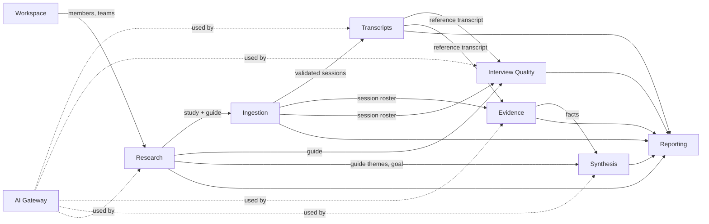

# Domain model & context map

> Living document. It is the reference for the ubiquitous language: code, API, UI and specs use these terms. Any change goes through a spec (`/speckit-specify`) or an ADR.

## Product in one sentence

goodresearch helps teams **design better user studies and trust their answers**: prepare an interview guide, collect recordings and transcripts, clean them, check interview conduct, extract evidence (facts), synthesise it into insights and recommendations, and present them — with **AI proposing and humans validating** at every step.

## Core principle: AI proposes, humans decide

Every AI-produced object follows the same lifecycle and the same protections. This is a cross-cutting domain rule, not a UI detail.

- Status: `proposed → validated | rejected`. Only humans validate or reject.
- `edited` objects are never overwritten by a new AI pass.
- Regeneration is **incremental**: it adds, it never rewrites or deletes human decisions.
- Removed links are kept as tombstones (`removed`) so the AI never re-adds them.
- Rejected items are fed back to the AI as "do not propose again".
- Anything the AI quotes (terms, quotes, original text) is **verified verbatim** against the source, otherwise dropped.
- Derived metrics (confidence, polarity, talk share, priority) are **computed by the app, deterministically**, never by the model.
- **Review policy** (`auto` = proposals count unless rejected, `manual` = only validated items count) is a **project-level** setting applied **at read time**. It never mutates data.

## Subdomains and bounded contexts

| # | Context | Subdomain type | Modelling style | Main aggregates |
|---|---|---|---|---|
| 1 | **Workspace** | Generic | CRUD + auth library | Workspace, Account, Member, Team (with memberships), UserPreferences |
| 2 | **Research** | Core | Domain model | Project, Study, InterviewGuide, PlannedInterview |
| 3 | **Ingestion** | Supporting | Domain model (matching rules) | Source, Session (with its roster) |
| 4 | **Transcripts** | Supporting | Domain model | Transcript, LexiconTerm, CorrectionRun |
| 5 | **Interview Quality** | Core | Domain model | Evaluation, Remark, ReviewRun |
| 6 | **Evidence** | Core | Domain model | Participant, Fact |
| 7 | **Synthesis** | Core | Domain model + policies | Insight, Recommendation, KeyTakeaways, PublishedDeck |
| 8 | **Reporting** | Supporting | Read models only (no aggregates) | — (project overview, deck, graph, evidence chain, exports) |
| 9 | **AI Gateway** | Generic | Adapters + ledger | AI provider connection, UsageEntry (append-only), PricingCatalog |
| 10 | **Assistant** | Supporting | Plain handlers + proposal rules | Conversation (messages, action proposals) |
| 11 | **Publishing** | Supporting | Domain model (three-way sync) | PublishedDocument (base, state, Drive changes) |

Background jobs (`Job`, per-item progress, stop, retry) are **shared infrastructure** used by contexts 3–7, not a context of their own.

Integration rules between contexts: reference by **ID only**, communicate through each module's **public API** (`index.ts`) or **domain events**. No shared tables, no cross-module imports of internals.

## Ubiquitous language

### 1. Workspace

- **Workspace** — the tenant (one per instance for now). Holds members, teams, provider configuration (LLM, sources) and organisation context given to the AI (replaces any hard-coded company context).
- **Account** — a person who can sign in, only through an external identity provider (no passwords), active, deactivated or deleted. New accounts come from a provider sign-in, filtered by the deployer's **initial admin emails** and **access allow-list** (emails and email domains).
- **Member** — an account in the workspace, with a role: `admin` (manages teams, members and access; sees everything) or `member`. The last active admin cannot be demoted or deactivated.
- **Team** — the unit of access and ownership. Unique name per workspace (case/space-insensitive). A team with projects or studies cannot be deleted.
- **TeamMembership** — links an account to a team (an account can be in several teams). A member sees and edits exactly the projects of their teams; a new member starts with none.
- **AccessEvent** — immutable record of an access change (who, on whom, what, when); admins consult it per account.
- Account lifecycle: `active ⇄ deactivated → deleted`. Deletion anonymises the account (name and email erased) so references and history stay consistent. Provider sign-in requires a verified email unless the deployer trusts the provider; a verified (or trusted) email matching an active account attaches to it.
- **UserPreferences** — interface language (`fr`, `en`).

### 2. Research

- **Project** — a research question. `name`, `goal` (question, objectives, hypotheses — given to the AI everywhere), `reviewPolicy` (`auto | manual`), **exactly one team** (required; access follows the team). Linked to 0..n studies (many-to-many, spec 019). Its key takeaways are owned by the Synthesis context.
- **Study** — one source of evidence, owned by **exactly one team**, linked to zero or more projects of that team (spec 019). It has its own **research goal**, a copy of its project's at creation, read by its AI steps; the project's goal is read by the AI steps over the project. A study in no project stays on its team's **Studies page**. Facts belong to the study, so a decision on a fact applies in every linked project. `type` (`interviews` first; `survey`, `usability-test`, `documents`, `analytics` later), phases **Preparation → Fieldwork → Enrichment → Analysis** (Enrichment, spec 010: the team lexicon, then Cleaning, spec 011, on the validated interviews; Analysis, spec 012: verbatims and facts per interview). Setting **text analysed** (spec 012): `with-corrections` (default: the raw version with every correction of Cleaning not rejected, those still to decide included) or `clean-only` (the latest validated clean version).
- **InterviewGuide** (spec 006) — the protocol of an interview study, at most one per study: a **framing** (objectives with the research themes, hypotheses, audience, format) and ordered **sections** of kind `introduction | warm-up | theme | wrap-up`, each with a title, a duration and ordered main **GuideQuestions** (app `id`, `text`, follow-ups). Versioned, with its origin (`assistant` when an assistant proposal was applied, `person` when edited by hand). Question ids are kept when a new version has the same question (same id sent back, or same text). Limits: 12 sections, 60 main questions, 8 follow-ups each. It is the hub: it feeds evaluation coverage, insight themes and the deck.
- **PlannedInterview** (spec 006) — one row of a study's **interview schedule**: the person to interview, role, interviewers, date and time, status (`to-contact | invited | scheduled | done | postponed | cancelled`), notes. Holds names of real people: never sent to an AI provider (the assistant only gets counts per status).
- **PublishedDocument** — an export of something the app owns (guide, best-practices, schedule) to an external tool. The app stays the source of truth. Until a publishing adapter exists, the guide and the best practices download as Markdown and the schedule as CSV.

### 3. Ingestion

- **Source** — where a study's files live (`Connector`: Google Drive first; upload, other drives later). Holds the last **inventory** of files with `kind` (`transcript | media | other`) and `group` (first-level folder).
- **Source connection** — a person's own grant to read a connector (e.g. Drive), separate from sign-in, encrypted, revocable; never used for someone else's request.
- **Folder access** — a study with a source folder has a second access barrier: on top of the project's team, a person must have access to the folder at the source. Without it they see only the study's name and type. Admins can always detach the folder or delete the study.
- **Session** (spec 008, the "interviews" of the Fieldwork phase) — one interview occurrence: at most one transcript file + 0..n ordered media files, at least one file. Each transcript of the inventory gives one session, to decide by a person; a recording no transcript claims gets a session of its own, without transcript (shown with a warning); at most 500 per study. A Google document is a transcript only when one of its tabs holds the transcript (meeting notes alone are not interviews); a file without speaker turns or timestamps is a summary, and its analysis excludes it (spec 009). `state` `proposed | validated | excluded` (with an optional exclusion reason); each media file has a confidence `high | medium | low` and a reason, or was added by a person; optional custom title; optional link to a **PlannedInterview** of the schedule (at most one session per planned interview).
- **Roster** — the people of a session, owned by the Session: **Interviewers** (the people conducting it, optionally linked to a workspace Member; for now the person's own account) and **Interviewees** (the people interviewed). Prefilled from the linked planned interview, edited by people. Other contexts reference roster entries by ID.
- **Interview analysis** (spec 009, part of the Session) — one reading of the beginning of the transcript (4,000 characters, up to 8,000 when nobody is found) that makes **Proposals**: interviewees, interviewers (linked to a team member when exactly one matches), interview date, language, the **normalised name** `YYYY-MM-DD – Interviewees – Interviewers – Kind` (kind `Transcript`/`Video`/`Audio`, `Transcription`/`Vidéo`/`Audio` in French), and **attachments** (other files of the group sharing the meeting title or a rare word). The app's rules come first (header date, participants line, speaker labels, file names, planned interview, team members); the AI is asked only for what is missing, receives only the text read (never the schedule or the team), and each AI proposal carries a quote checked in the text. Each proposal has an origin and a status `proposed | accepted | edited | rejected | already-set`; a new analysis never replaces a decided one nor proposes again a rejected value. Accepting fills the roster, the interview date and language, and the title; the files are then renamed in Drive with the person's own write access (names only). Costs: every call is in the usage ledger under `session-analysis:<id>`, shown per interview and in total for the study, whoever ran it. An **Analysis run** analyzes the study's open interviews in the worker, one run per study.
- **Anonymisation** (study setting, off by default) — names and titles use **pseudonyms** (`P01`…) assigned once per interviewee of the study in the order of interview dates, never reused; the names the app knows are replaced by placeholders in what is sent to the AI. Replacing names inside the text belongs to Cleaning (spec 011): interviewees become their pseudonym, interviewers an **interviewer label** ("Interviewer 1"…, code `I01`… kept with the pseudonyms, numbered once per study in the order of interview dates), other people's names "[Person]".
- **Matching policy** — matches media files to sessions from file metadata. Rules (initial heuristic): only within a group; timestamps within 1 minute → high; ≤15 min, or the same day with a shared rare word → medium; shared rare word without date → low; different days → incompatible; a tie on the best leaves the file unmatched. A rare word appears in ≤3 files of the group (numbers, words under 3 letters and common words such as "interview" or "transcript" excluded).
- **Link suggestion** — the planned interview a proposed session probably belongs to, computed by the app at read time (never stored, never by an AI provider: the schedule holds real names): first the planned interviewee sharing the most name words with the interviewees found in the transcript (spec 009, accepted or proposed), then with the transcript's file name, a unique best only; otherwise the only planned interview within 24 hours of the interview date (else the file's date). The person confirms or picks another one; when none matches, the interview can be added to the schedule (a planned interview, done, linked to it). Once linked, the interview and its planned interview share who and when, both ways (spec 009); the schedule keeps its status, role and notes.
- Validation: every session waits for a person (`proposed`: shown "Proposed" until analyzed, then "To decide (X)" with what its analysis and the schedule leave to decide); a person's decision (validate, exclude, or undo) freezes it. (Spec 008 had sessions with their transcript validated by the app; spec 009 dropped it, migration 0023.)
- Invariants: each inventory adds sessions for new transcripts and removes only sessions no person decided whose transcript is gone; sessions a person validated or excluded, and their files, are **frozen** (one whose file left the folder is kept, "file missing in Drive"); a file belongs to one session at most; reopening ("back to review") is the only way to change a decided session; replacing or detaching the folder discards the sessions.

### 4. Transcripts

- **Transcript** — the text of a session, with **versions**: `raw` (imported, immutable) and successive `clean` versions. Each version is a list of **Segments**. Spec 010 imports the raw version of each **validated** interview the first time Enrichment reads it, and again only when its file changed in Drive (unchanged turns keep their ids); the text is deleted with its session. **Clean versions** (spec 011): numbered, validated by a person when nothing is left to decide, same turn ids as the raw version, the raw version untouched; later phases read the latest one.
- **Segment** — one speaker turn: `id` (**stable across versions**), `speaker`, `start`/`end` (nullable), `text`. Everything downstream anchors on `(transcriptVersionId, segmentId, offsets)` — never on a positional index.
- **TranscriptParser** — strategy per format (VTT, SRT, plain `Speaker: text`, meeting-notes exports…). Unusable input → `unavailable` with a reason.
- **Speaker mapping** — explicit, user-validated mapping from transcript speaker labels to **roster** entries (interviewer or interviewee) of the session (replaces name heuristics everywhere).
- **LexiconTerm** (spec 010) — team-level entry per language (the team that owns the study's project; a cross-team, global lexicon comes later): `form` (the correct form; for a `suspect` term, what the transcription wrote), `kind` (`domain`: a real term; `suspect`: a probable transcription error, with its `correction`), `category` (`product | organisation | place | acronym | jargon | role | person | other`), `definition`, status `proposed | accepted | edited | rejected | merged`, and its **variants** (other spellings, each `proposed | accepted | rejected`). One active term per form in a team and language. Has **Occurrences** (counts per interview, recomputed by the app at each reading), a `scope` (`global | case-by-case`) and **Verdicts** (a person's yes/no on one occurrence in its context, kept across readings while the turn is unchanged, moved by a merge). Cleaning (spec 011): `global` → every occurrence corrected except verdicts *no*; `case-by-case` → only verdicts *yes*, the others decided in context.
  - **Lexicon reading** ("Find terms", one per study at a time, in the worker): imports the transcripts, finds **candidates** by the app's rules (words absent from the common words of the language, capitalised words inside a sentence, acronyms, spellings close to a known term; known names, speaker labels and decided spellings left out; at most 300), then asks the AI to group them into terms. The AI gets only the candidates with at most 3 excerpts of 200 characters each, the names the app knows replaced by placeholders (anonymisation on or off), never a full transcript; variants must be among the candidates and quotes in the excerpts. Costs: ledger ref `lexicon-reading:<runId>`, shown on the Lexicon tab (its own phase since spec 012, before Enrichment) for every account.
  - Decisions: accept, edit, reject, reopen, merge (the merged term's spellings move to the kept one, which counts as accepted). A new reading never changes a decided term, only adds proposed variants, and never proposes a rejected spelling again.
  - Match rule: whole word/phrase; all-caps acronyms case-sensitive, others case-insensitive. Same rule server and UI (shared package).
  - Default scope `case-by-case` when a counted spelling has ≤3 characters (spec 010; "spread much wider than flagged" may come with Cleaning); user choice wins once set.
  - Re-extraction never overwrites a human decision; while undecided, `suspect` wins over `domain`.
- **CorrectionRun** (spec 011, "Clean transcripts", one Enrichment run per study, in the worker) — mode `lexicon` (no AI, no cost) or `ai` (the full transcript in chunks of 60 turns with 5 turns of context, known names as placeholders; consent `cleaning`; ledger ref `cleaning:<runId>:<sessionId>` (per interview, as an analysis)). It produces **Edits** — "corrections" in the UI — (`segmentId`, target `text | speaker`, offset, original, replacement, kind `term | transcription | speaker | name`, `source` `person | lexicon | name | ai-lexicon | ai-other`, reason, confidence, status `proposed | accepted | edited | rejected`).
  - `lexicon` (the former `rule`) and `name` edits are computed from the lexicon, its verdicts and the study's people at each read; a decision on a lexicon edit **is** the verdict of its occurrence. `ai-*` and `person` edits are stored; every AI edit waits for a person, changes at most 8 words of one turn and is checked against the turn.
  - Overlap priority: person > lexicon > name > ai-lexicon > ai-other. An identical edit inherits the earlier human decision.
  - **Validating** creates a new clean version; **publishing** writes it to a Google Doc in the study folder's "Clean transcripts" subfolder (the original never written; edits made in Drive are not brought back).
  - Interview states: not cleaned, to clean again (raw re-imported or anonymisation changed), corrections to decide, lexicon changed, clean, published, out of date.

### 5. Interview Quality

Spec 016: how the interviews were conducted, as facts to read: no score, no verdict, no ranking.

- **Evaluation** — the last review of one interview: what it read, the sentences counted per speaker label, what the checks left out. State derived: no transcript, not clean yet, speakers not identified, not measurable, not reviewed, reviewing, to review again, reviewed.
- **Review** ("Review the interviews", one per study, never with a lexicon reading, a cleaning or a facts reading; queue `quality.review`; ledger ref `quality:<runId>:<sessionId>`) — the app cuts interviewers' turns into numbered sentences (fragments of at most 2 words not counted), and the AI answers on those that are a question, a simple reformulation or that orient the answer.
- **Simple reformulation** — rests only on what the interviewee said, to check understanding: good practice, counted apart, no remark. A person can requalify one, writing the reason.
- **Remark** — a flagged sentence, exact by construction: **leading question**, **reformulation with opinion** (adds something the interviewee did not say, and names it; checked against what they said before) or **opinion or suggestion**; a reason (English and French), a recommended wording, origin `ai | person`. It applies nothing.
- **Opinion** (`stance` in code) — a person's `agree` or `disagree` on a remark: an **assessment that applies nothing**, outside the proposal lifecycle (constitution IV, 1.2.0). A remark counts until someone disagrees; every total shows agreed, no opinion, disagreed. The project's review policy does not apply. A new review keeps opinions and never flags again what was disagreed with.
- **Figures** — computed by the app, shown only for interviews reviewed, adding up across Overall, By person and By interview: talk share and speaking times, sentences and questions, leading ones. Reference values, in tooltips only: interviewer talk share 30% at most, leading sentences 5% at most. Above 95% of interviewer words: not measurable. No interviewer word, or more than 20% of the words of no known person: speakers not identified, never a false 0%.

### 6. Evidence

- **Participant** — anonymous research profile of an interviewee (references a roster entry): `role`, `team`, `description`, status. Gets a **stable pseudonym** (`P01`…) at workspace level, assigned once. Evidence owns the profile; Ingestion owns who was in the session.
- **Verbatim** (spec 012) — an exact excerpt of an interviewee's turn (3 to 120 words) in the text analysed: turn, place, text, participant (their code; null while the speaker is to attribute), origin (`ai | person`). Verified word for word or dropped; never from an interviewer. No decision of its own: a person adds one by highlighting text, or **sets it aside** (never proposed again). Found again in the current text at each read (**re-anchoring**); one no longer found is flagged "text changed", never deleted.
- **Fact** — an atomic piece of evidence: neutral `statement` in English **and** French (no names; a person's edit in one language is translated into the other in the background, ledger ref `facts-translation:<sessionId>`), supported by 1..n **verbatims** of one interview, `polarity` (`positive | negative | neutral`), **theme** (a `theme` section of the guide, or "Other"), origin (`ai | person`), status `proposed | accepted | edited | rejected`. Spec 012 builds it per interview in two AI passes (verbatims part by part, then facts); only accepted and edited facts are findings.
  - **AnalysisRun** ("Find facts", one per study, never with an Enrichment run; queue `evidence.facts`; ledger ref `facts:<runId>:<sessionId>`). Interview states: no transcript, not clean yet, not analysed, to analyse again (a verbatim lost, a transcript re-imported, the setting or the anonymisation changed — not a word corrected), facts to decide, done.
  - Speakers: a label matching an interviewer is not evidence; one matching an interviewee is theirs; with one interviewee, an unknown label is theirs; otherwise a person attributes it (to an interviewee or "an interviewer").
  - Only participant speech produces facts. Quote verified (tolerant to case/whitespace/apostrophes) or dropped.
  - Incremental extraction; duplicates (same segment and contained quote or ≥60% shared words) are discarded.
  - Manual facts are created validated; deleting an AI fact rejects it (so it is never proposed again).
  - Attribution follows the speaker mapping: fixing a mapping re-attributes facts without re-extraction.
  - When a new transcript version is published, quotes are **re-anchored**; facts whose quote disappeared are flagged, not deleted.

### 7. Synthesis

- **Insight** (spec 013) — project-level finding over the **accepted facts** of the project's studies (and, on request, those still to decide, shown "to validate" and counted once accepted): theme, statement and description (English and French), counter-evidence, minority view, origin (`ai | person`), status (`proposed | validated | edited | rejected`). Links to facts with a **role** (`support | counter`, one per fact) and a **state** (`counted`; `suggested`: added by a run to a decided insight, counted once a person accepts it; `unlinked`: removed by a person, never linked again by a run). Each link keeps the fact as it was (snapshot); a fact rejected, deleted, outside the project or changed since shows **Evidence changed** until a person marks it **Reviewed**.
  - Only known fact refs may be cited; an insight without valid support is dropped; at most 25 new insights per run; a run never changes a decided insight's texts.
  - **ConfidencePolicy**: panel = participants (one roster person of one study) with accepted facts in the project. High ≥ max(5, 30% of panel) supporting participants; Medium ≥3; Low otherwise; counter-evidence from ≥50% as many participants lowers one level. The prototype's team condition (≥3 teams, no team >50%) comes back with participant profiles.
  - **PolarityPolicy**: neutral if polarised facts <30%; positive/negative if ≥60% of polarised; mixed otherwise.
  - Themes come from the guides' theme sections, merged by title across studies (+ "Other").
- **InsightRun** (spec 013) — one "Find insights" over a project: studies and scope chosen (`all` or facts not yet in an insight), calls done of total, stopped or finished, cost; one at a time per project.
- **Recommendation** (spec 014) — `action`, `rationale`, `successMeasure` (English and French), `kind` (`build | test | investigate`), `impact`/`effort` (high/medium/low), `owner` (free text, never sent to the AI), status, links to insights (state `counted | suggested | unlinked`, with the insight's snapshot). A `build` whose counted insights all have a low confidence is shown as `test`. **PriorityPolicy** = impact×2 − effort (high 3, medium 2, low 1). Insights still to decide may be read on request, shown "to validate", counted once validated; "Insights changed" until "Reviewed". Listed in creation order.
- **Project overview** (spec 017) — a read model, stored nowhere, of the project's Overview tab: the **journey** of five steps (`interviews`, `facts`, `insights`, `recommendations`, `debrief`, each `empty | to-decide | done`), the **next step** (the first not done; it advises and prevents nothing; Interviews is done from its first validated interview), the key takeaways, and the counts and costs of the studies. A study without folder access is left out of the counts, not of the project's total cost.
- **KeyTakeaways** (spec 014) — the project's 2–4 sentence summary (one per project, EN/FR). The AI may draft it from the validated insights and recommendations (no name, no percentage); a draft is never saved without a person. "May be out of date" when the validated insights or recommendations changed since it was saved.

### 8. Reporting (read models)

**Project overview** (spec 017, module `reporting`): see its definition above. Screen-shaped reads across the modules, through their ports.

**Debrief deck** (spec 015, built by Synthesis as a read model): the project's slides built from its data each time it is opened, never stored, in the prototype's layout; only what is validated, or also what is still to decide, marked "to validate". Its next steps are written from the data; no limits slide for now. Its Google Slides copy, **PublishedDeck** (file, folder, language, the deck's fingerprint to tell "out of date", the presentation's content revision to tell "changed in Google Slides"), is kept by Synthesis. Then: project graph, evidence chain (recommendation → insights → facts → sessions), anonymised fact export (CSV: no names, no session titles), costs. Built from queries; no aggregates, no writes.

### 10. Assistant (spec 005)

- **Conversation** — a person's chat with the assistant, private to them: messages (person / assistant, with status complete, stopped or failed) and the page each message was sent from.
- **Page context** — built on the server with the person's own permissions at each message (project, goal, studies; study, phase, folder name only with folder access); never file names or contents.
- **Study change** (spec 019) — attaching or detaching a study, or changing its goal: action proposals run during the answer, so a refusal reaches the assistant at once. It receives the team's other studies (names and projects only) on a project page.
- **Project deletion** (spec 020) — for good, by an admin or the project's creator, with the project's exact name typed by the person. Its insights, recommendations and key takeaways go; its studies stay. The assistant only shows a card: its tool takes no name, the usual Apply refuses this card, and a dedicated route takes the name from the person.
- **Page opening** — the assistant can also open a project or study page the person can access (a tool too, run at once: it changes no data).
- **Action proposal** — an action the assistant proposes through a tool (create a project or study, rename them, write the research goal, write the whole interview guide). It changes nothing until the person applies it; applying runs the Research commands with the person's permissions and the version seen at proposal time; it is decided once (applied, dismissed or failed), and the outcome is given back to the assistant.
- **Skill** (spec 006) — instructions for a task (project framing on every page, interview guide design on an interview study) that the assistant loads with a tool when the task comes up; the context lists the available skills, and a loaded skill stays in the context for the rest of the conversation.
- **Tools run during the answer** (spec 006) — loading a skill and **checking questions** (the app's fixed writing rules: closed, leading, hypothetical, about the future, asking for a solution, double, too long): run by the app, their result goes back to the assistant, which goes on in the same answer. A **project proposal** (spec 018) too: it returns the card's confirmation or the reason of its refusal. **Reporting the progress** of a guide design or a project framing is recorded when called and ends the answer.
- **Guide design progress** (spec 006) — the latest progress report of a conversation: for each of the eight points (objectives and themes 15, hypotheses 10, audience 15, format 10, introduction and warm-up 10, thematic questions 25, follow-ups 10, bias review 5) whether it is missing, partial or covered; the app computes the percentage.
- **Project framing** (spec 018) — the dialogue before proposing a project, and its latest progress report in a conversation: five points (research question 30, audience 20, decision to support 25, hypotheses 15, team 10). The app refuses a project proposal until every point is done, and composes the research goal from the question, objectives and hypotheses. A framing ends when its project is applied; a new card replaces an open one.
- **Continuing answer** (spec 018) — the answer the assistant gives on its own right after a project is applied, on the project's page, without a message from the person; only one, and only if the conversation has not gone on.

### 9. AI Gateway

- **AI provider connection** (spec 004) — one per person: Vertex AI with the person's own Google account (project and region), or an Anthropic or OpenAI API key. Checked by a real call before saving, encrypted, used only for that person's own actions. The deployer chooses which providers are offered and the model of each.
- **Gateway** (`runTask`: structured output validated by a schema, or streamed text) — resolves the caller's connection, runs the call, classifies failures into a closed set (invalid credential, permission, no credit or quota, rate limit, model unavailable, API disabled, unreachable). Adapters per provider via the Vercel AI SDK.
- Concurrency cap per provider credential, retries with backoff on transient errors.
- **UsageEntry** — **single append-only ledger**: person, task, provider, model, tokens in and out, duration, outcome, `ref` (what the call was for, e.g. an assistant message); never prompt or answer text (spec 004). Cost is computed at read time from a dated **PricingCatalog**; a failed call without counted tokens costs nothing, a stopped answer stays unknown (built-in prices for the default models, deployer prices with `AI_PRICES`; spec 005).

### 11. Publishing (spec 007)

- **PublishedDocument** — a file created from a study's preparation in the study's source folder: the interview guide and the best practices as documents, the schedule as a spreadsheet. It keeps the **base** (the content as read back right after the last write), the file's state and its **Drive changes**. Shared by everyone who can act on the study; files are read and written with the acting person's own source access (an editing consent asked when publishing; the person must be able to edit the file at the source).
- **Item identity** — invisible anchors in documents (one per framing heading, section and main question) and a hidden id column in spreadsheets, so a reworded question or a sorted sheet keeps its items.
- **Three-way sync** — for each item, base, app and file are compared: changed in the app only → the file is **out of date** ("Update in Drive" rewrites the same file); changed in the file only → a **Drive change** to review; changed on both sides, differently → a **conflict**; unreadable text → **not understood**; a value breaking the app's rules → **invalid**. Nothing read from Drive changes the app without a person's decision, and a file with unreviewed changes is never rewritten unless the person explicitly replaces them.
- **Drive change** — decided once (accepted or rejected, shared by the team). Accepted changes go through the Research commands (guide origin `drive`); rejected ones are replaced at the next update. The best practices are fixed content: their Drive changes are reported, never brought back.
- **States**: in sync, out of date, changed in Drive, conflict, unavailable (deleted, trashed, moved out of the folder, or no access). Checked when the Preparation tab opens (at most every 5 minutes) and on demand; never deleted at the source.

## Bilingual glossary

Code, API and docs use the English term. The UI ships in English and French; translators use this table so a term is always translated the same way. A new domain term is added here in the same PR that introduces it.

| English (code & UI) | French (UI) | Notes |
|---|---|---|
| Workspace | Espace de travail | |
| Account | Compte | |
| Member | Membre | |
| Admin / Member (roles) | Admin / Membre | |
| Team membership | Appartenance à une équipe | |
| Access allow-list | Liste d'accès autorisés | |
| Access history | Historique des accès | |
| Deactivate / Delete account | Désactiver / Supprimer le compte | Delete = anonymise |
| Team | Équipe | |
| Project | Projet | The research question |
| Research goal | Objectif de recherche | |
| Study | Étude | A method run to collect evidence; "Experiment" is not used (implies A/B testing) |
| Study type: interviews | Entretiens | Later: survey (Questionnaire), usability test (Test utilisateur) |
| Preparation / Fieldwork / Enrichment / Analysis | Préparation / Passation / Enrichissement / Analyse | Study phases |
| Interview guide | Guide d'entretien | |
| Guide question | Question du guide | |
| Attach / Detach a study | Rattacher / Détacher une étude | Link it to a project, or remove the link |
| Framing | Cadrage | Objectives, hypotheses, audience, format of a guide |
| Project framing | Cadrage du projet | The dialogue before proposing a project |
| Follow-up | Relance | |
| Section kinds: introduction / warm-up / theme / wrap-up | Introduction / Questions introductives / Thématique / Conclusion | |
| Guide design progress | Avancement de la conception du guide | |
| Interview schedule | Planning des entretiens | |
| Planned interview | Entretien planifié | Statuses: À contacter, Invité, Planifié, Réalisé, Reporté, Annulé |
| Interview best practices | Bonnes pratiques d'entretien | |
| Skill | Skill | Instructions the assistant loads for a task |
| Writing check | Vérification des questions | |
| Source | Source | |
| Source folder | Dossier source | |
| Inventory | Inventaire | |
| Connected sources | Sources connectées | |
| Session | Session | UI label is "Interview / Entretien" for interview studies |
| Proposed / Validated / Excluded (session) | Proposé / Validé / Exclu | States of a session |
| Link suggestion | Suggestion | "Suggested: … (name in the file name / same date)" |
| Transcript | Transcription | |
| Segment | Tour de parole | One speaker turn |
| Speaker | Locuteur | |
| Speaker mapping | Attribution des locuteurs | |
| Roster | Personnes de l'entretien | |
| Interview analysis | Analyse de l'entretien | Spec 009 |
| Proposal (accept / change / reject) | Proposition (accepter / modifier / rejeter) | |
| Normalised name | Nom normalisé | `YYYY-MM-DD – Interviewees – Interviewers – Kind` |
| Attachment | Pièce jointe | A file that belongs to an interview |
| Anonymisation | Anonymisation | Study setting |
| Pseudonym | Pseudonyme | `P01`… per study for now |
| Interviewer | Intervieweur | |
| Interviewee | Personne interviewée | |
| Participant | Participant | Pseudonym `P01`… in both languages |
| Lexicon | Lexique | |
| Term (domain / suspect) | Terme (métier / douteux) | UI kinds: "Term / Terme" and "Transcription error / Erreur de transcription" |
| Variant | Graphie | "Spellings found / Graphies trouvées" in the UI |
| Lexicon reading (Find terms) | Lecture du lexique (Trouver les termes) | Spec 010 |
| Merge (terms) | Fusionner | |
| Occurrence | Occurrence | |
| Verdict | Verdict | UI: "This is the term / C'est bien ce terme", "Not this term / Pas ce terme", "Can't tell / Je ne sais pas" (`unsure`: left to decide in Cleaning) |
| Scope (everywhere / case by case) | Portée (partout / au cas par cas) | "Where to correct / Où corriger" in the UI |
| Cleaning | Nettoyage | Spec 011, second step of Enrichment |
| Correction run (Clean transcripts) | Passe de correction (Nettoyer les transcriptions) | |
| Edit (correction) | Modification (correction) | "Correction" in the UI |
| Clean version | Version propre | Validate the clean version / Valider la version propre |
| Clean transcripts (Drive folder) | Transcriptions nettoyées | |
| Interviewer 1 | Intervieweur 1 | Interviewer label under anonymisation |
| Publish (a transcript version) | Publier | |
| Evaluation | Évaluation | |
| Talk share | Part de parole | Percentage of words |
| Speaking time | Temps de parole | The minutes (spec 016) |
| Quality (tab) | Qualité | Spec 016 |
| Review the interviews / Review / Review again / Review anyway | Relire les entretiens / Relire / Relire à nouveau / Relire quand même | Spec 016 |
| Remark | Remarque | A flagged sentence |
| Leading question | Question orientée | |
| Simple reformulation | Reformulation simple | Never counted as leading |
| Reformulation with opinion | Reformulation avec opinion | |
| Opinion or suggestion | Opinion ou suggestion | A kind of remark |
| Opinion: agree / disagree / no opinion | Avis : d'accord / pas d'accord / sans avis | `stance` in code, never "accept" or "reject" |
| Overall / By person / By interview | Global / Par personne / Par entretien | |
| Not reviewed / To review again / Reviewed | Non relu / À relire / Relu | |
| Not measurable / Speakers not identified / Not clean yet | Non mesurable / Locuteurs non identifiés / Pas encore propre | |
| Interviewer not identified | Intervieweur non identifié | |
| Fact | Fait | |
| Verbatim | Verbatim | An exact excerpt of what an interviewee says (spec 012) |
| Set aside (a verbatim) | Écarter | |
| Text analysed: with the corrections / validated clean version only | Texte analysé : avec les corrections / version propre validée seulement | Study setting (spec 012) |
| Find facts | Trouver les faits | Again: « … à nouveau », as every repeat action |
| Quote | Citation | |
| Polarity (positive / negative / neutral) | Polarité (positive / négative / neutre) | |
| Insight | Insight | Common term in French UX research |
| Confidence (high / medium / low) | Confiance (élevée / moyenne / faible) | |
| Counter-evidence | Contre-exemples | |
| Minority view | Point de vue minoritaire | Spec 013 |
| Polarity of an insight: mixed | Mitigé | Spec 013, computed by the app |
| Supports / Goes against (a fact's role) | Soutient / Va contre | Spec 013 |
| Evidence changed / Reviewed | Preuves modifiées / Vérifié | Spec 013 |
| Find insights | Trouver des insights | |
| Recommendation | Recommandation | |
| Owner (of a recommendation) | Responsable | Free text (spec 014) |
| Success measure | Mesure du succès | |
| Find recommendations | Trouver des recommandations | |
| May be out of date (key takeaways) | Peut-être obsolète | |
| Kind: build / test / investigate | Type : construire / tester / investiguer | |
| Impact / Effort | Impact / Effort | |
| Key takeaways | Points clés | |
| Debrief deck | Restitution | Spec 015, the project's 4th tab |
| Who does what (debrief) | Qui fait quoi | Spec 015, written from the data |
| Quick wins / Major projects / Small extras / To reconsider | Gains rapides / Chantiers structurants / Petits plus / À reconsidérer | Quadrants of the impact × effort matrix |
| To validate | À valider | Shown on what is still to decide |
| Out of date / In sync (published deck) | Pas à jour / À jour | Spec 015 |
| Evidence chain | Chaîne de preuves | |
| Review policy (auto / manual) | Mode de revue (automatique / manuel) | |
| Proposed / Validated / Rejected | Proposé / Validé / Rejeté | |
| Job | Traitement | Background job |
| Usage ledger | Journal de consommation | |
| AI provider | Fournisseur IA | Each person's own Vertex AI, Anthropic or OpenAI account |
| Assistant | Assistant | The chat panel available on every page |
| Conversation | Conversation | |
| Action proposal | Proposition | Shown as a card with Apply / Dismiss |
| Apply / Dismiss | Appliquer / Ignorer | |
| Published file | Fichier publié | In the study's source folder |
| Publish / Update in Drive | Publier / Mettre à jour dans le Drive | |
| In sync / Out of date / Changed in Drive / Conflict / Unavailable | À jour / Pas à jour / Modifié dans le Drive / Conflit / Indisponible | States of a published file |
| Drive change | Modification du Drive | Accept / Reject = Accepter / Refuser |
| Not understood | Non compris | Text read from Drive that matches no item |

## Domain events (initial list)

`SessionValidated`, `RosterChanged`, `TranscriptImported`, `TranscriptVersionPublished`, `LexiconTermDecided`, `CorrectionRunCompleted`, `SpeakerMappingChanged`, `FactValidated`, `FactRejected`, `InsightValidated`, `StudyAttachedToProject`, `StudyDetachedFromProject`.

Events are enqueued in the same transaction as the state change (pg-boss, see ADR-0004); consumers are idempotent.

## Known design corrections vs. the prototype

| Prototype issue | Decision |
|---|---|
| Positional `segment_idx` shared across contexts, quotes re-anchored by rewriting | Stable segment ids + explicit transcript version refs |
| Per-user review mode mutating shared data | Project-level policy, applied at read time only |
| Name-based heuristics for speakers/interviewers/attribution | Explicit, validated speaker mapping |
| Two usage ledgers | One append-only ledger |
| In-memory job state | Durable jobs (Postgres) |
| Pseudonyms recomputed per project | Stable pseudonyms assigned once |
| Company context hard-coded in prompts | Workspace-level organisation context |
| Single provider (one LLM, one file source) | Ports + adapters for LLM, sources, publishing |

## Open questions

- ~~Lexicon scope~~: per team (spec 010); a global, cross-team lexicon later.
- ~~Where fieldwork scheduling lives~~: in the app (PlannedInterview, spec 006); publishing to a spreadsheet would be a PublishedDocument adapter.
